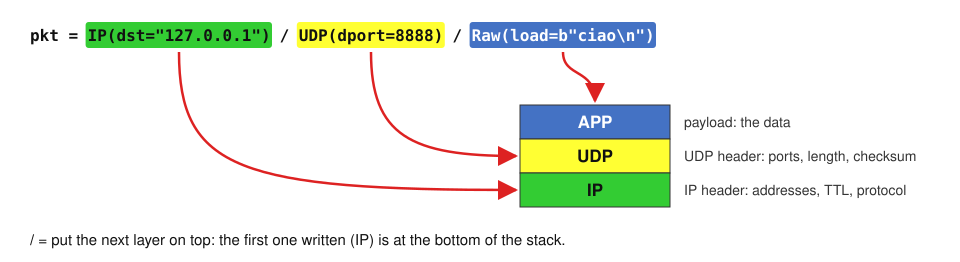
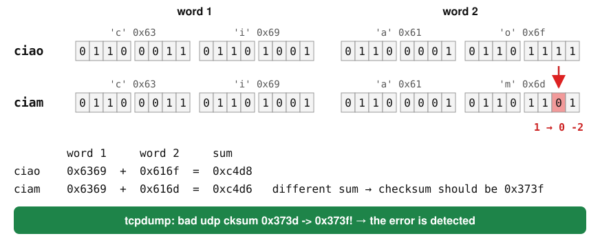
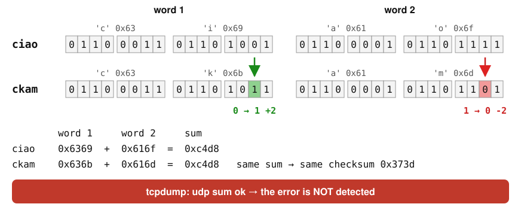

# Forging packets with Scapy (Linux / macOS)

Reference: Kurose & Ross, *Computer Networking*, Ch. 3 (Sec. 3.3: UDP and the UDP checksum)

Scapy is a Python library that builds packets **field by field**: you choose every header value (addresses, ports, TTL, checksum...) and send the packet on the network. Install: it is in the `reti_calcolatori` environment (see [00_PYTHON_ENVIRONMENT_SETUP](../00_PYTHON_ENVIRONMENT_SETUP/README.md)).

Windows: run everything inside WSL (Ubuntu), as on Linux.

**Root is needed**: building a packet is allowed to everyone, sending one is not. Start the Scapy shell as root with the Python of the environment: `sudo $(which scapy)` (a plain `sudo scapy` would not find the environment). All the commands below are typed inside the Scapy shell (`>>>` prompt), unless they say otherwise.

Loopback interface: `lo` on Linux / WSL, `lo0` on macOS.

### The Scapy functions used in this lab

| Function | What it does | First used in |
|---|---|---|
| `IP(dst=...)` | build an IP header; `src` is filled in automatically | 1 |
| `UDP(dport=...)` | build a UDP header | 1 |
| `/` | stack a layer on top of the previous one | 1 |
| `p.summary()` | print the packet on one line | 1 |
| `p.show()` | print every field of every layer | 1 |
| `ls(UDP)` | list all the fields of a layer, with their default values | 1 |
| `Raw(load=...)` | the payload: raw bytes carried by the packet | 2 |
| `send(p)` | send a packet (layer 3), do not wait for an answer | 2 |
| `sniff(...)` | capture packets and call a function for each one | 3 |
| `DNS(qd=DNSQR(qname=...))` | build a DNS query | 4 |
| `sr1(p)` | send a packet and wait for **one** answer | 4 |
| `IP(ttl=...)` | Time To Live: how many routers the packet may cross | 5 |

Online: [Scapy usage guide](https://scapy.readthedocs.io/en/latest/usage.html).

---

## 1. Build a packet layer by layer

> A packet is a stack of headers. In Scapy each header is an object, and `/` puts one on top of the other.



### Command

Build an IP header towards `8.8.8.8` and print it.

```python
p = IP(dst="8.8.8.8")
p.summary()
```
**Expected output**
```
10.8.9.16 > 8.8.8.8 ip
```
The source address is your machine's IP: Scapy filled it in.

### Command

Stack a UDP header on top of IP.

```python
p = p / UDP()
p.summary()
```
**Expected output**
```
IP / UDP 10.8.9.16:domain > 8.8.8.8:domain
```
Default ports are 53 (`domain`, the DNS port).

### Command

Print every field.

```python
p.show()
```
**Expected output**
```
###[ IP ]###
  version   = 4
  ihl       = None
  ...
  ttl       = 64
  proto     = udp
  chksum    = None
  src       = 10.8.9.16
  dst       = 8.8.8.8
###[ UDP ]###
     sport     = domain
     dport     = domain
     len       = None
     chksum    = None
```
`len` and `chksum` are `None`: Scapy computes them only when the packet is turned into bytes, just before sending.

### Command

List all the fields of UDP.

```python
ls(UDP)
```
**Expected output**
```
sport      : ShortEnumField                      = ('53')
dport      : ShortEnumField                      = ('53')
len        : ShortField                          = ('None')
chksum     : XShortField                         = ('None')
```
The whole UDP header: 4 fields of 16 bits (Kurose, Fig. 3.7).

---

## 2. Send a datagram to ncat

> The packet is forged by hand, but the receiver is a normal UDP server: it cannot tell the difference.

### Command

In the left pane (normal terminal) start a UDP server, as in [05_SOCKET](../05_SOCKET/README.md):

```bash
ncat -u -l -k 8888
```

> [!WARNING]
> <details>
> <summary><b>Troubleshooting</b>: "UDP mode does not support the -k or --keep-open options"</summary>
>
> Old versions of ncat do not accept `-k` in UDP mode. Ubuntu (and so WSL) installs ncat 7.80, which stops with:
> ```
> Ncat: UDP mode does not support the -k or --keep-open options, except with --exec or --sh-exec. QUITTING.
> ```
> Check in WSL (or Linux) which version you have:
> ```bash
> ncat --version
> ```
> If you see `Ncat: Version 7.80 ( https://nmap.org/ncat )`, your ncat does not support `-k` in UDP mode: use the workaround below. On macOS Homebrew installs a recent version (7.97), where `-k` works.
>
> Workaround: as UDP server use `server-udp.py` (in [05_SOCKET](../05_SOCKET/)) instead of `ncat -u -l -k 8888`. It listens on the same port 8888, accepts datagrams from any client, and prints each one with the address of the sender.
> </details>

### Command

In the Scapy shell, send a datagram with payload `ciao`.

```python
pkt = IP(dst="127.0.0.1") / UDP(sport=55555, dport=8888) / Raw(load=b"ciao\n")
send(pkt)
```
**Expected output**
```
.
Sent 1 packets.
```
**Server output**
```
ciao
```
`sport=55555`: we chose the source port ourselves. With a normal socket the system chooses it.

The same steps are in the script `scapy_udp_sender.py` (random payload instead of `ciao`).

---

## 3. Sniff the datagram with Scapy

> Scapy can also capture: for each UDP packet to port 8888 it prints the header fields, checksum included.

### Command

In a third pane, start `scapy_udp_sniffer.py` as root (set `IFACE` to `lo` on Linux / WSL, `lo0` on macOS). Then send `pkt` again from the Scapy shell.

```python
send(pkt)
```
**Sniffer output**
```
---  UDP packet received ---
SRC port: 55555
DST port: 8888
Length: 13
Checksum: 14141 [0x373d]
Payload: b'ciao\n'
----------------------------
```
- `Length: 13`: 8 bytes of UDP header + 5 bytes of payload (`ciao` + newline).
- `Checksum: 0x373d`: computed by Scapy over the pseudo-header, the UDP header and the payload. We will use it in the final exercise.

---

## 4. Send and receive: a DNS query

> `sr1()` sends a packet and waits for the answer: here we build a DNS query by hand.

### Command

Send the query to your local DNS server, the `nameserver` line of `/etc/resolv.conf` (see [04_DNS](../04_DNS/README.md), section 1). In the university network it is `147.163.12.104`: public DNS servers like `8.8.8.8` are blocked there.

```python
richiesta = IP(dst="147.163.12.104") / UDP(dport=53) / DNS(qd=DNSQR(qname="unipa.it"))
risposta = sr1(richiesta, verbose=0)
risposta[DNS].an[0].rdata
```
**Expected output**
```
'147.163.149.59'
```
- `qd`: the question section of the DNS message; `DNSQR` is one question (name `unipa.it`, type A by default).
- `an`: the answer section, a list of records; `an[0]` is the first record, and `rdata` is its value, the IP address.

Try `risposta.show()` to see the whole answer, layer by layer.

---

## 5. TTL: one router at a time

> Every router decreases the TTL by 1. When it reaches 0, the router drops the packet and sends back an ICMP "time exceeded" message: so we learn who it is.

### Command

```python
destinazione = "1.1.1.1"
risposta = sr1(IP(dst=destinazione, ttl=1) / UDP(), timeout=2, verbose=0)
risposta.src
```
**Expected output**: the IP address of your first router (at home usually `192.168.1.1`).

### Command

Repeat with `ttl=2`, `ttl=3`, ...

```python
risposta = sr1(IP(dst=destinazione, ttl=2) / UDP(), timeout=2, verbose=0)
risposta.src
```
Each answer comes from the next router on the path: this is how `traceroute` works. If a router does not answer, `risposta` is `None`: skip to the next TTL.

---

## 6. A fake source address

> Scapy lets you write any `src`: the IP header is not checked by anyone.

### Command

```python
falso = IP(src="1.2.3.4", dst="8.8.8.8") / ICMP()
falso.show()
send(falso, verbose=0)
```
We use `send()`, not `sr1()`: the answer of `8.8.8.8` goes to `1.2.3.4`, not to us. Many networks drop packets with a source address that does not belong to them.

---

## 7. Break the channel: the UDP checksum

> The UDP checksum detects a flipped bit, but two flips in opposite directions can cancel out (Kurose, slides 3-30 and 3-33).

Scapy plays the role of a noisy channel: it computes the checksum of `ciao`, then changes the payload and **keeps the old checksum**. Whoever receives the packet recomputes the checksum and compares.

The receiver that checks here is **tcpdump**: with `-vv` (very verbose) it recomputes the checksum of every packet and flags the wrong ones. (We do not use a socket as receiver: on the loopback the kernel may skip the check, because a packet that never leaves the machine cannot be corrupted.)

Setup: the Scapy shell in the right pane, and the capture in the left pane (on macOS write `lo0`):

```bash
sudo tcpdump -i lo -n -vv udp port 8888
```

### Step 1: the payload

Start from the top of the stack: the application data, 5 bytes (`ciao` + newline).

```python
dati = Raw(load=b"ciao\n")
dati.show()
```
**Expected output**
```
###[ Raw ]###
  load      = b'ciao\n'
```

### Step 2: the UDP header

Choose the ports: source `55555`, destination `8888`.

```python
udp = UDP(sport=55555, dport=8888)
udp.show()
```
**Expected output**
```
###[ UDP ]###
  sport     = 55555
  dport     = ddi_udp_1
  len       = None
  chksum    = None
```
`ddi_udp_1` is just the service name Scapy knows for port 8888. `len` and `chksum` are still empty: UDP does not know yet what it carries, nor to which IP addresses.

### Step 3: the IP header

```python
ip = IP(dst="127.0.0.1")
```

### Step 4: stack the layers

```python
pkt = ip / udp / dati
pkt.summary()
```
**Expected output**
```
IP / UDP 127.0.0.1:55555 > 127.0.0.1:ddi_udp_1 / Raw
```
The packet is complete, but `pkt[UDP].chksum` is still `None`: Scapy computes it only when it turns the packet into bytes.

### Step 5: freeze the checksum

Turn the packet into bytes (`bytes(pkt)`: here Scapy computes `len` and `chksum`) and read the bytes back as a packet (`IP(...)`).

```python
pkt = IP(bytes(pkt))
pkt[UDP].show()
```
**Expected output**
```
###[ UDP ]###
  sport     = 55555
  dport     = ddi_udp_1
  len       = 13
  chksum    = 0x373d
###[ Raw ]###
     load      = b'ciao\n'
```
- `len = 13`: 8 bytes of UDP header + 5 bytes of payload.
- `chksum = 0x373d`: the checksum of `ciao`. From now on it is a fixed value: Scapy will **not** recompute it, even if we change the payload.

<details>
<summary>How is 0x373d computed?</summary>

The UDP checksum adds 16-bit words taken from three places: a **pseudo-header** (some fields of the IP header), the **UDP header** (with the checksum set to 0 while computing) and the **data**. If the data has an odd number of bytes, a 0 byte is added at the end.

```
7f00  source IP 127.0              ┐
0001  source IP 0.1                │
7f00  destination IP 127.0         │ pseudo-header
0001  destination IP 0.1           │
0011  zero + protocol 17 (UDP)     │
000d  UDP length 13                ┘
d903  source port 55555            ┐
22b8  destination port 8888        │ UDP header
000d  length 13                    │
0000  checksum (0 while computing) ┘
6369  "ci"                         ┐
616f  "ao"                         │ data
0a00  "\n" + one 0 byte of padding ┘
-----
2c8c0   sum
 c8c2   wraparound: the carry (2) is added back at the end: c8c0 + 2
 373d   one's complement: every bit is inverted → checksum
```
The receiver does the same sum, this time with the checksum included: if the result is `ffff` (all 1s), the datagram is accepted.
</details>

### Step 6: send `ciao` (healthy channel)

```python
send(pkt)
```
**tcpdump output**
```
IP (...) 127.0.0.1.55555 > 127.0.0.1.8888: [udp sum ok] UDP, length 5
```
Checksum and data agree: `udp sum ok`.

### Step 7: flip one bit

`o` → `m` is one bit: `o` is `0110 1111`, `m` is `0110 1101` (the bit of value 2 goes from 1 to 0). `ciao` becomes `ciam`. The checksum stays `0x373d`.

```python
pkt[Raw].load = b"ciam\n"
send(pkt)
```

**Q1**: what does tcpdump say? Is the error detected?

<details>
<summary>Q1</summary>

Yes, the error is **detected**: tcpdump prints `[bad udp cksum 0x373d -> 0x373f!]`. The checksum of `ciam` should be `0x373f`, but the packet carries `0x373d`.


 On a real network the receiver's kernel would **silently drop** this datagram: UDP does not ask for it again, the application never sees it.
</details>

### Step 8: flip two bits that cancel out

How to build an error that the checksum cannot see, in three moves.

**1. Cut the payload into 16-bit words.** The checksum adds the data 2 bytes (16 bits) at a time:
```
 c  i  |  a  o  |  \n
 word 1   word 2   word 3
```

**2. Write in binary one letter of word 1 and one of word 2.** Take the second letter of each word: `i` and `o`.
```
letter   hex    binary
i        0x69   0110 1001
o        0x6f   0110 1111
                       ^
                       bit of value 2
```
Look at the bit of value 2 (second from the right): in `i` it is **0**, in `o` it is **1**.

**3. Mirror the two bits**: in `i` the 0 becomes 1, in `o` the 1 becomes 0.
```
i   0110 1001  →  0110 1011  = 0x6b = k     (+2)
o   0110 1111  →  0110 1101  = 0x6d = m     (-2)
```
`ciao` becomes `ckam`. Now add the words:
```
         word 1     word 2     sum
ciao     0x6369  +  0x616f  =  0xc4d8
ckam     0x636b  +  0x616d  =  0xc4d8
```
Word 1 gained 2, word 2 lost 2: **the sum is the same**.

`0xc4d8` is not the checksum: it is only 2 of the 13 words that the checksum adds (see *How is 0x373d computed?* in Step 5). All the other words (pseudo-header, UDP header, `\n`) did not change. So the total sum is the same as before, and the checksum is still `0x373d`.

Send it:

```python
pkt[Raw].load = b"ckam\n"
send(pkt)
```

**Q2**: what does tcpdump say this time? Why?

<details>
<summary>Q2</summary>

tcpdump says `udp sum ok`: the error is **not detected**, even if two bits changed. Any receiver would accept `ckam` as if it were the message sent. The checksum only looks at the sum of the words, and two opposite changes in the same bit position cancel out. It is the case of slide 3-33: the Internet checksum is a weak protection.



Compare with Q1: `ckam` is `ciam` plus one more flip (`i` → `k`) that brings the sum back.
</details>

### Step 9: no checksum at all

In IPv4 the UDP checksum is optional: the value `0` means "the sender did not compute it". Build a new packet and write `chksum=0` yourself: Scapy keeps it and does not compute anything.

```python
pkt = IP(dst="127.0.0.1") / UDP(sport=55555, dport=8888, chksum=0) / Raw(load=b"ciao\n")
pkt[Raw].load = b"zzzz\n"
send(pkt)
```

**Q3**: what does tcpdump say? Would a receiver accept `zzzz`?

<details>
<summary>Q3</summary>

tcpdump prints `[no cksum]`: there is nothing to check. A receiver accepts the datagram whatever it contains, even `zzzz` instead of `ciao`: no error can be detected. In IPv6 this is not allowed: the UDP checksum is mandatory.
</details>
