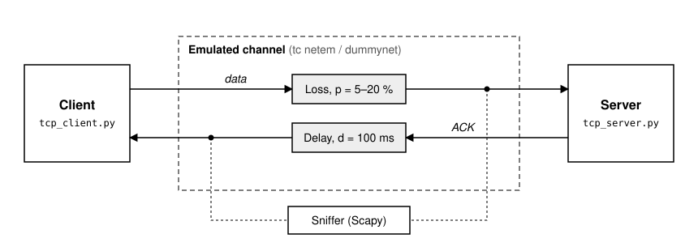

# TCP SACK and Timestamps

Kurose & Ross, Ch. 3: Sec. 3.4.3 (GBN, SR), Sec. 3.5.3 (RTT, timeout).

Real kernel TCP on the loopback. An emulator loses the data and delays the ACKs. Two Scapy sniffers show the options.



The sniffer sees each packet when it comes out of the channel, so lost packets never reach it. The data has no delay, so RTT = ACK delay.

- `tcp_server.py`: port 12000, reads everything.
- `tcp_client.py`: `--n` chunks of `--size` bytes (also the MSS, default 1000), one every `--interval` s (0 = all at once).
- `01_sack_sniffer.py`: one line per segment, with the SACK blocks of the ACKs.
- `02_rto_sniffer.py`: SampleRTT from the timestamps, then EstimatedRTT, DevRTT, RTO.

Panes: server, client, sniffer. On Linux the sniffer needs sudo.

## Emulator (sudo)

Data (to port 12000): loss. ACKs (from port 12000): delay. RTT = ACK delay.

Linux / WSL:
```
sudo ethtool -K lo tso off gso off
sudo tc qdisc add dev lo root handle 1: prio
sudo tc qdisc add dev lo parent 1:1 handle 10: netem loss 5%
sudo tc qdisc add dev lo parent 1:3 handle 30: netem delay 0ms
sudo tc filter add dev lo parent 1: protocol ip u32 match ip dport 12000 0xffff flowid 1:1
sudo tc filter add dev lo parent 1: protocol ip u32 match ip sport 12000 0xffff flowid 1:3
```
Change: `sudo tc qdisc change dev lo parent 1:1 handle 10: netem loss 10%` (data), `sudo tc qdisc change dev lo parent 1:3 handle 30: netem delay 100ms` (ACKs).
Stop: `sudo tc qdisc del dev lo root; sudo ethtool -K lo tso on gso on`

macOS:
```
sudo dnctl pipe 1 config plr 0.05
sudo dnctl pipe 2 config delay 0
printf "dummynet out on lo0 proto tcp from any to any port 12000 pipe 1\ndummynet out on lo0 proto tcp from any port 12000 to any pipe 2\n" | sudo pfctl -f -
sudo pfctl -e
```
Change: `sudo dnctl pipe 1 config plr 0.1` (data), `sudo dnctl pipe 2 config delay 100` (ACKs).
Stop: `sudo pfctl -f /etc/pf.conf; sudo pfctl -d; sudo dnctl -q flush`

---

## 1. SACK

Emulator: data **loss 20 %**. Start `01_sack_sniffer.py`, then the client with `--n 10 --interval 0.1`. Losses are random: each run is different.

One line per segment: time from the start (ms), ports, relative `seq` / `ack`, payload length. An ACK with the SACK option adds its blocks: `SLE` = first byte, `SRE` = last byte + 1. Connection setup and close (SYN, FIN) are shown only as `CONNECTION` lines.

**Sniffer output** (real run, macOS, heavy loss)
```
------- CONNECTION open -------
ts:00334,SPORT:63821,DPORT:12000,seq:03001,ack:00001,data_len:1000
ts:00439,SPORT:63821,DPORT:12000,seq:04001,ack:00001,data_len:1000
ts:00485,SPORT:63821,DPORT:12000,seq:00001,ack:00001,data_len:1000
ts:00486,SPORT:12000,DPORT:63821,seq:00001,ack:01001,data_len:0,SACK,SLE:03001,SRE:05001
ts:00786,SPORT:63821,DPORT:12000,seq:01001,ack:00001,data_len:1000
ts:01786,SPORT:63821,DPORT:12000,seq:01001,ack:00001,data_len:1000
ts:04588,SPORT:63821,DPORT:12000,seq:01001,ack:00001,data_len:1000
ts:04588,SPORT:12000,DPORT:63821,seq:00001,ack:02001,data_len:0,SACK,SLE:01001,SRE:02001,SLE:03001,SRE:05001
ts:05842,SPORT:63821,DPORT:12000,seq:02001,ack:00001,data_len:1000
ts:05843,SPORT:12000,DPORT:63821,seq:00001,ack:05001,data_len:0
------- CONNECTION close -------
```
- `ack:01001` + `SLE:03001,SRE:05001`: the receiver has 1-1000, **misses 1001-3000**, has 3001-5000 (kept out of order, as in SR).
- `seq:01001` is sent again and again: each time the RTO doubles (≈ 1 s, then ≈ 3 s).
- `SLE:01001,SRE:02001` is below `ack:02001`: a **D-SACK**, "I got 1001-2000 twice" (an earlier copy arrived, its ACK was lost).
- The sender sends again **only the hole** 2001-3000, GBN would send everything from 2001. Then the ACK jumps to 5001.

---

## 2. Timestamps: Karn and Jacobson

Emulator: data **loss 10 %**, ACK **delay 100 ms**. Start `02_rto_sniffer.py`, then the client with `--n 400 --interval 0.05`.

`SampleRTT` = time of the ACK - time of the segment whose `TSval` the ACK copies in `TSecr`.

What to look for (example values):
```
    t(ms)  pkt  seq/ack      TSval      TSecr  Sample  EstRTT  DevRTT     RTO
   1205.3  DATA    5001       1100
   1505.3  DATA    5001       1400              RETX: by seq ambiguous (Karn), by TSval ok
   1605.4  ACK     6001                  1400   100.1   101.2     4.3   118.4   <- of the RETX
```
**Karn**: by seq number the ACK of a retransmission may belong to either copy, so TCP skips the sample and doubles the timeout. With `TSecr` it is clear which copy came back.

**Jacobson** (the sniffer's columns):
```
EstimatedRTT    = 7/8 · EstimatedRTT + 1/8 · SampleRTT
DevRTT          = 3/4 · DevRTT + 1/4 · |SampleRTT - EstimatedRTT|
TimeoutInterval = EstimatedRTT + 4 · DevRTT
```

While the client is sending, change the ACK delay to **300 ms**. `Sample` jumps at once. `EstRTT` climbs slowly (1/8 per sample). `DevRTT` and `RTO` grow at once, so there is no early timeout.

Compare with the kernel (Linux): `ss -ti dport = :12000` → `rtt:EstRTT/DevRTT rto:RTO` in ms (Linux keeps `rto` ≥ 200 ms).

---

Docs: [RFC 2018 (SACK)](https://www.rfc-editor.org/rfc/rfc2018), [RFC 7323 (Timestamps)](https://www.rfc-editor.org/rfc/rfc7323), [RFC 6298 (RTO)](https://www.rfc-editor.org/rfc/rfc6298), [tc-netem](https://man7.org/linux/man-pages/man8/tc-netem.8.html), [dnctl](https://keith.github.io/xcode-man-pages/dnctl.8.html), [Scapy sniff](https://scapy.readthedocs.io/en/latest/usage.html#sniffing).
