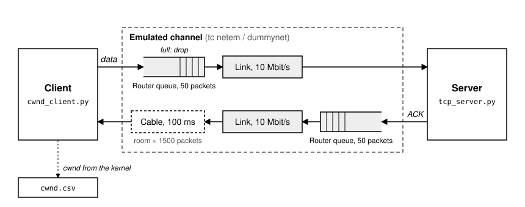
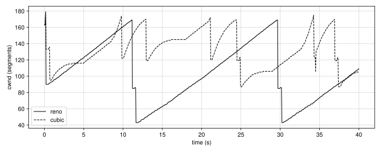

# TCP congestion control: NewReno vs Cubic

Kurose & Ross, Ch. 3: Sec. 3.7 (TCP congestion control, TCP CUBIC).

A client sends as fast as it can to a server on your own machine (loopback). An emulator in the middle is a **bottleneck**: a slow link with a short queue. When the queue is full a packet is dropped and TCP reduces its congestion window `cwnd`. The client reads `cwnd` from its own kernel and saves it in a CSV file.



- **Data**: router queue (50 packets), then the link (10 Mbit/s). This is the queue of the textbook: it fills up and drops packets.
- **ACKs**: the same router queue and link (a real link has both directions), then the cable (100 ms). ACKs are small (52 bytes against 1052): their queue stays almost always empty.
- The cable holds every packet in flight: in the emulator we give it room for ≈ 1500 packets, in practice unlimited.

RTT ≈ 100 ms.

| File | What it does |
|---|---|
| `tcp_server.py` | receives everything on port 12000, from many clients at the same time |
| `cwnd_client.py` | sends for `--time` seconds; every `--every` seconds prints and saves `time,cwnd,ssthresh` |
| `plot_cwnd.py` | draws the `cwnd` of one or more CSV files in `--out` (default `cwnd.png`; also `.svg`, `.pdf`) |

| Option | What it does (default) |
|---|---|
| `--cc` | algorithm, `reno` or `cubic`, **Linux only** (cubic) |
| `--time` | seconds of sending (30) |
| `--every` | seconds between two samples (0.05) |
| `--out` | CSV file for the samples (cwnd.csv) |

Output columns: `time` = absolute time ([Unix time](https://docs.python.org/3/library/time.html#time.time): seconds since 1 Jan 1970), `cwnd` and `ssthresh` in segments (MSS = 1000 bytes). `plot_cwnd.py` puts time 0 at the first sample of all its files. Before the first loss `ssthresh` is only a placeholder (0 or a big number): ignore it.

---

## Theory

- **Reno**: in congestion avoidance `cwnd` grows by 1 MSS per RTT (a straight line). At a loss (3 duplicate ACKs): `ssthresh = cwnd / 2`, `cwnd = ssthresh`. Result: a **sawtooth**.
- **Cubic**: at a loss `cwnd` goes down only to **0.7 ·** `cwnd`. Then it grows as a cubic function of the time since the loss: fast when far from the old maximum, slow near it (concave), then fast again to look for more bandwidth (convex).

> **Reno or NewReno?** macOS calls it NewReno, Linux calls it `reno`: both are NewReno. Same `cwnd` rules as Reno; the only difference is fast recovery when **more than one** segment is lost in the same window: Reno exits at the first new ACK, NewReno stays until all of them are retransmitted.

---

## Setup

Open two terminals: one for the **server**, one for the **client**.

Start `tcp_server.py` in the server terminal. Leave it running for all the exercises.

---

## Emulator (sudo)

The emulator gives the data packets (to port 12000) a queue of 50 packets and a 10 Mbit/s link; the ACKs (from port 12000) get the same queue and link, then a cable of 100 ms with room for ≈ 1500 packets. All its commands need `sudo`.

> **Preview.** Here `tc` (Linux) and `dnctl` (macOS) are only a tool: copy the commands as they are. We will study network emulation in much more detail later in the course.

Read **only the part for your system**.

> [!WARNING]
> ⚠️ **Coming from lab 08?** Run its **Stop** commands first: an old loss or delay setting left in the emulator spoils every result here.

### Linux / WSL

**Start** (once).
```
sudo ethtool -K lo tso off gso off
sudo tc qdisc add dev lo root handle 1: prio
sudo tc qdisc add dev lo parent 1:1 handle 10: netem rate 10mbit limit 50
sudo tc qdisc add dev lo parent 1:3 handle 30: netem delay 100ms limit 1500
sudo tc qdisc add dev lo parent 30:1 handle 31: tbf rate 10mbit burst 1540 limit 52000
sudo tc filter add dev lo parent 1: protocol ip u32 match ip dport 12000 0xffff flowid 1:1
sudo tc filter add dev lo parent 1: protocol ip u32 match ip sport 12000 0xffff flowid 1:3
```
Data: `limit 50` is the router queue (packets), `rate` the link speed. ACKs: `netem delay 100ms limit 1500` is the cable (room for 1500 packets), then `tbf` is the link (`rate`) with its router queue (`limit`, in bytes: 52000 ≈ 50 packets).

**Change: random loss** (only for exercise 4).

Activate: 0.1 % of the data packets are lost.
```
sudo tc qdisc change dev lo parent 1:1 handle 10: netem rate 10mbit limit 50 loss 0.1%
```
Remove: back to no loss.
```
sudo tc qdisc change dev lo parent 1:1 handle 10: netem rate 10mbit limit 50 loss 0%
```
`loss` is the probability of losing a packet. Always write the **whole** line: `change` replaces all the settings, and without `rate` and `limit` the bottleneck is gone.

**Stop** (at the end).
```
sudo tc qdisc del dev lo root
sudo ethtool -K lo tso on gso on
```
Details: [man tc-netem](https://man7.org/linux/man-pages/man8/tc-netem.8.html).

### macOS

**Start** (once).
```
sudo dnctl pipe 1 config bw 10Mbit/s queue 50
sudo dnctl pipe 2 config bw 10Mbit/s queue 50 delay 100
printf "dummynet out on lo0 proto tcp from any to any port 12000 pipe 1\ndummynet out on lo0 proto tcp from any port 12000 to any pipe 2\n" | sudo pfctl -f -
sudo pfctl -e
```
In a dummynet pipe a packet goes through the router queue (`queue`, packets), then the link (`bw`), then the cable (`delay`, ms; it has no size limit). Pipe 1 = data, pipe 2 = ACKs. `pfctl` prints some warnings (`flushing of rules`, `No ALTQ`): they are normal.

**Change: random loss** (only for exercise 4).

Activate: 0.1 % of the data packets are lost.
```
sudo dnctl pipe 1 config bw 10Mbit/s queue 50 plr 0.001
```
Remove: back to no loss.
```
sudo dnctl pipe 1 config bw 10Mbit/s queue 50 plr 0
```
`plr` (packet loss rate) is the probability of losing a packet, from 0 to 1: 0.001 = 0.1 %. Always write the **whole** line: `config` replaces all the settings of the pipe, and without `bw` and `queue` the bottleneck is gone.

**Stop** (at the end).
```
sudo pfctl -f /etc/pf.conf
sudo pfctl -d
sudo dnctl -q flush
```
Details: [man dnctl](https://keith.github.io/xcode-man-pages/dnctl.8.html).

### Check that it works

Start `cwnd_client.py --time 10` in the client terminal.

- Emulator **working**: `cwnd` stays below ≈ 180 segments and falls down at each loss.
- Emulator **not active**: `cwnd` grows to thousands of segments. Run the **Start** commands again. On macOS this happens after every reboot.
- `cwnd` always falls around 50 or less: an old setting is still there (see the warning above). Run **Stop**, then **Start**.

---

## Choose the algorithm

The first line of the client output tells which algorithm is in use, e.g. `congestion control: cubic`.

- **Linux / WSL**: per connection, with the `--cc` option of the client. No `sudo`.
- **macOS**: one switch for the whole system, `--cc` is ignored. 1 = NewReno, 0 = Cubic (the default):
  ```
  sudo sysctl -w net.inet.tcp.use_newreno=1
  ```
  At the end set it back to 0.

How the client does it (only to read the code):
- Linux: `setsockopt(TCP_CONGESTION)` chooses the algorithm, `getsockopt(TCP_INFO)` returns `cwnd` and `ssthresh` ([man tcp](https://man7.org/linux/man-pages/man7/tcp.7.html)).
- macOS: `sysctl -n` reads the switch, `getsockopt(TCP_CONNECTION_INFO)` returns `cwnd` and `ssthresh` in bytes.
- `struct.unpack_from("I", info, 80)` reads the 4-byte number at byte 80 of the kernel answer ([Python struct](https://docs.python.org/3/library/struct.html)).

---

## 1. Cubic

**Step 1.** Choose **Cubic** (Linux: `--cc cubic`; macOS: `use_newreno=0`).

**Step 2.** Start `cwnd_client.py --cc cubic --time 40 --out cubic.csv` in the client terminal.

**Step 3.** Watch `cwnd` and `ssthresh` while it runs.

Example (real run, macOS):
```
time,cwnd,ssthresh
1793869173.520,172,95
1793869173.560,174,95
1793869173.610,122,122
1793869173.670,122,122
...
1793869179.360,143,119
1793869179.410,144,119
```

What to find in your output:
- At each loss, `ssthresh` ≈ **0.7 ·** the `cwnd` just before it.
- After a loss `cwnd` grows fast, becomes flat near (a bit below) the old maximum, then speeds up again.

---

## 2. NewReno

**Step 1.** Choose **NewReno** (Linux: `--cc reno`; macOS: `use_newreno=1`).

**Step 2.** Start `cwnd_client.py --cc reno --time 40 --out reno.csv` in the client terminal.

Example (real run, macOS):
```
time,cwnd,ssthresh
1793868550.320,169,90
1793868550.370,169,90
1793868550.410,85,85
1793868550.470,85,85
...
1793868550.820,86,85
1793868550.860,43,43
```

What to find in your output:
- At each loss, `ssthresh` ≈ **half** of the `cwnd` just before it.
- Sometimes a second loss comes a few RTTs later: `cwnd` halves again (here 169 → 85 → 43).
- After a loss `cwnd` grows by ≈ 1 every RTT: with one sample every 0.05 s, +1 every 2–3 lines (the queue adds up to 40 ms to the RTT).

---

## 3. Compare

Start `plot_cwnd.py reno.csv cubic.csv` in the client terminal and open `cwnd.png`.



What to find in the plot:
- NewReno: a regular **sawtooth**, deep teeth (down to half), straight rising lines.
- Cubic: shallow teeth (down to 0.7), curved rising lines, flat near (a bit below) the old maximum.
- Cubic keeps a **larger `cwnd` on average** (here 131 segments against 103).
- The link is full with ≈ 120 segments in flight (10 Mbit/s × 100 ms): Cubic falls back to about that value, NewReno goes well below it and leaves the link partly empty for many seconds.

---

## 4. Random loss

Until now every loss came from the full queue: a **congestion** loss. Now we add losses that have nothing to do with congestion (e.g. a noisy radio link): TCP cannot tell the difference.

**Step 1.** Activate 0.1 % loss with the **Change: random loss** command of your system.

**Step 2.** Repeat exercises 1 and 2 with `--out cubic_loss.csv` and `--out reno_loss.csv`.

**Step 3.** Start `plot_cwnd.py reno_loss.csv cubic_loss.csv --out cwnd_loss.png` and open `cwnd_loss.png`.

<!-- TODO: example plot from a real run -->

What to find in the plot:
- Losses come at **random** `cwnd` values, well below 170: the queue is no longer the reason.
- Both stay below the ≈ 120 segments needed to fill the link: part of the link is wasted.
- Cubic suffers less: it falls only to 0.7 and climbs back faster.

**Step 4.** Remove the random loss with the **Remove** command of your system.

---

## 5. Together (optional)

Until now each algorithm had the bottleneck all for itself. Two connections can also **share** it at the same time: the server reads many clients at once.

**Step 1.** In two client terminals, start one NewReno and one Cubic client a few seconds apart, with `--out reno_mix.csv` and `--out cubic_mix.csv`.
- Linux / WSL: `--cc reno` in one, `--cc cubic` in the other.
- macOS: the switch counts when a connection **opens**. Set `use_newreno=1`, start the first client, set `use_newreno=0`, start the second one.

**Step 2.** Start `plot_cwnd.py reno_mix.csv cubic_mix.csv --out mix.png`. Both clients write absolute time: in the plot the two curves line up, even if one client started a few seconds later.

The two flows now compete for the same queue: how they share the link is the topic of **TCP fairness** (Kurose Sec. 3.7.2).

---

## References

For the curious, to study the details:
- [RFC 5681](https://www.rfc-editor.org/rfc/rfc5681): TCP congestion control (Reno)
- [RFC 6582](https://www.rfc-editor.org/rfc/rfc6582): NewReno
- [RFC 9438](https://www.rfc-editor.org/rfc/rfc9438): CUBIC
