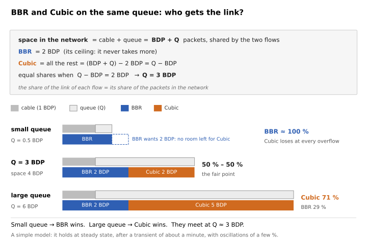

# Network performance with iperf: TCP and UDP on an emulated channel

Kurose & Ross: Ch. 1, Sec. 1.4 (delay, loss, throughput), Ch. 3, Sec. 3.3 (UDP), Sec. 3.6-3.7 (TCP congestion control).

How fast can we send data? It depends on the **channel**, the link speed (**rate**), the delay (**RTT**), the size of the router **queue**, and on the **protocol**: TCP adapts its speed to the channel, UDP does not. We measure all of this with **iperf**, a tool made to measure networks, on the emulated channel of [09_CONGESTION_CTL](../09_CONGESTION_CTL/).

| | TCP | UDP |
|---|---|---|
| speed decided by | the congestion control (cwnd), from the ACKs | the program: iperf sends at the rate you ask (`-b`) |
| if the link is slower | slows down: few losses, retransmitted | goes on: what does not fit is **lost** |
| depends on the RTT | yes: cwnd grows once per RTT, and it must cover RTT × rate | no: no ACKs to wait for |
| what iperf shows (`-e`) | throughput, retransmissions (`Rtry`), cwnd and RTT of the kernel | throughput, lost packets, jitter, one-way latency |

---

## Setup

The emulator uses `tc`: it needs `sudo`.

**Step 1.** Install iperf (version 2: the commands below are for iperf 2, not iperf3):
```bash
sudo apt install iperf
iperf --version      # iperf version 2.x
```

**Step 2.** Open **three terminals** in this folder. Start the two servers, TCP and UDP, both on port **12000**, and leave them running for the whole lab:
```bash
iperf -s -p 12000 -e -i 1          # terminal 1: TCP server
iperf -s -u -p 12000 -e -i 1       # terminal 2: UDP server
```
TCP port 12000 and UDP port 12000 are two different ports: the two servers do not disturb each other. Port 12000 because the emulator of lab 09 acts on it.

The third terminal is the **client**: all the commands below are run there.

**Step 3.** The emulator. You change the channel with one command, then measure:
```bash
RATE=10mbit DELAY=100ms QUEUE=50 ../09_CONGESTION_CTL/emulate_channel.sh start
```

| Variable | What it is | Default |
|---|---|---|
| `RATE` | link speed | `10mbit` |
| `DELAY` | delay of the cable: RTT ≈ `DELAY` | `100ms` |
| `QUEUE` | router queue, in packets | `50` |
| `LOSS` | random loss | `0%` |

How the channel is made: [09_CONGESTION_CTL, Emulator](../09_CONGESTION_CTL/README.md#emulator-sudo). In short: the data sent **to** port 12000 go through the router queue and the link; the packets coming back **from** port 12000 (the ACKs of TCP, the reports of iperf) go through the cable, which adds `DELAY`.

### The iperf commands

| | command (client) |
|---|---|
| TCP, 10 s | `iperf -c 127.0.0.1 -p 12000 -e -i 1 -M 1448 -t 10` |
| UDP at 5 Mbit/s, 10 s | `iperf -c 127.0.0.1 -p 12000 -e -i 1 -u -b 5M -t 10` |

- `-e`: enhanced report (retransmissions, cwnd, RTT, latency); `-i 1`: one line per second; `-t`: seconds.
- `-M 1448`: TCP segments of ≈ 1500 bytes, as on Ethernet. Without it, on the loopback TCP sends blocks of 64 KB, and a queue of "50 packets" would hold 3 MB.
- `-u -b 5M`: UDP, at 5 Mbit/s. UDP datagrams are 1470 bytes.

### How to read the output

The format of the lines (the numbers here are only an example). TCP, one line per second (client):
```
[ ID] Interval            Transfer    Bandwidth       Write/Err  Rtry     Cwnd/RTT(var)        NetPwr
[  1] 3.0000-4.0000 sec  1.12 MBytes  9.44 Mbits/sec  9/0          0      120K/115012(1200) us  ...
```
`Bandwidth` = throughput; `Rtry` = segments retransmitted (on this emulator it stays 0: see the note in Part 3); `Cwnd` = congestion window; `RTT` = RTT measured by TCP, in **µs** (115012 us = 115 ms).

UDP, at the end (client, `Server Report`, measured by the receiver):
```
[ ID] Interval            Transfer     Bandwidth        Jitter   Lost/Total  Latency avg/min/max/stdev ...
[  1] 0.0000-10.0 sec   11.6 MBytes  9.72 Mbits/sec   0.120 ms 4100/12750 (32%) 60.1/1.3/61.0/5.2 ms ...
```
`Lost/Total` = datagrams lost; `Latency` = one-way delay of the datagrams (client and server are on the same computer: same clock, exact).

The numbers in the tables below "expected" are computed from the theory: write your measures next to them.

---

## 0. Without the emulator

```bash
../09_CONGESTION_CTL/emulate_channel.sh stop
iperf -c 127.0.0.1 -p 12000 -e -i 1 -t 5
```
Tens of Gbit/s (a real run: 113 Gbit/s), RTT of a few µs: the loopback is memory copied by the CPU. Without the emulator the computer is never the bottleneck: every limit we see below comes from the channel.

---

## 1. Rate: high and low (TCP)

Short cable (10 ms) and a queue of 100 packets; only the rate changes:
```bash
RATE=1mbit   DELAY=10ms QUEUE=100 ../09_CONGESTION_CTL/emulate_channel.sh start
iperf -c 127.0.0.1 -p 12000 -e -i 1 -M 1448 -t 10
```
then the same with `RATE=10mbit` and `RATE=100mbit`.

| RATE | expected throughput | your measure |
|---|---|---|
| 1 Mbit/s | ≈ 0.95 Mbit/s | |
| 10 Mbit/s | ≈ 9.5 Mbit/s | |
| 100 Mbit/s | ≈ 95 Mbit/s | |

What to find: TCP fills the link, whatever its speed: the throughput is ≈ 95 % of RATE. The other 5 % are the headers (Ethernet, IP, TCP: 66 bytes on 1502), counted by the link but not by iperf.

---

## 2. RTT: low and high (TCP)

Link of 10 Mbit/s, queue of 50 packets; only the RTT changes. 20 s, because with a long RTT TCP needs time to grow (slow start doubles cwnd once per RTT):
```bash
RATE=10mbit DELAY=10ms QUEUE=50 ../09_CONGESTION_CTL/emulate_channel.sh start
iperf -c 127.0.0.1 -p 12000 -e -i 1 -M 1448 -t 20
```
then the same with `DELAY=100ms` and `DELAY=300ms`.

To keep the link always busy, TCP must have in flight at least **rate × RTT** bytes, the **bandwidth-delay product (BDP)**: the bytes "on the cable".

| DELAY (RTT) | BDP = rate × RTT | BDP in packets (1500 B) | queue | expected |
|---|---|---|---|---|
| 10 ms | 12.5 KB | ≈ 8 | 50 ≫ BDP | ≈ 9.5 Mbit/s, the link always full |
| 100 ms | 125 KB | ≈ 83 | 50 < BDP | still ≈ 9.5 Mbit/s, just enough (see below) |
| 300 ms | 375 KB | ≈ 250 | 50 ≪ BDP | clearly less: the link is often idle |

Why: when the queue overflows, TCP loses a packet and cuts cwnd (CUBIC: × 0.7). Just before the loss, cwnd = BDP + queue (the packets on the cable plus the ones in the queue). After the cut:
- RTT 100 ms: 0.7 × (83 + 50) ≈ 93 packets, still more than the BDP (83): the link never stops.
- RTT 300 ms: 0.7 × (250 + 50) = 210 packets, **less** than the BDP (250): until cwnd grows again, the link has nothing to send. And with a long RTT it grows again slowly (one step per RTT).

**The fix**: a queue as large as the BDP. With RTT 300 ms:
```bash
RATE=10mbit DELAY=300ms QUEUE=250 ../09_CONGESTION_CTL/emulate_channel.sh start
iperf -c 127.0.0.1 -p 12000 -e -i 1 -M 1448 -t 20
```
Expected: back to ≈ 9.5 Mbit/s after slow start. This is the classic rule for routers: **buffer ≈ rate × RTT**.

---

## 3. Queue: small and large (TCP)

Link of 10 Mbit/s, RTT 100 ms (BDP ≈ 83 packets); only the queue changes:
```bash
RATE=10mbit DELAY=100ms QUEUE=10 ../09_CONGESTION_CTL/emulate_channel.sh start
iperf -c 127.0.0.1 -p 12000 -e -i 1 -M 1448 -t 20
```
then the same with `QUEUE=100` and `QUEUE=1000`. Look at the columns `Bandwidth` and `Cwnd/RTT`.

A full queue adds delay: each packet waits for the ones in front of it, 1.2 ms each at 10 Mbit/s (1502 bytes × 8 / 10 Mbit/s). Most RTT = 100 ms + QUEUE × 1.2 ms.

| QUEUE | expected throughput | expected cwnd | most RTT |
|---|---|---|---|
| 10 (≪ BDP) | lower | often below the BDP (125 KB) | ≈ 112 ms |
| 100 (≈ BDP) | ≈ 9.5 Mbit/s | around the BDP and above | ≈ 220 ms |
| 1000 (≫ BDP) | ≈ 9.5 Mbit/s | very large (MB) | **≈ 1.3 s** |

What to find:
- **Small queue**: the queue is often full, TCP cuts cwnd below the BDP: lower throughput.
- **Large queue**: full throughput, but the RTT becomes 10 times larger. TCP fills any queue (it slows down only when a packet is lost), so a large queue stays full: every packet, also the ones of other programs (a video call, a game, a DNS query), waits 1.2 s in it. It is called **bufferbloat**.
- The best queue is ≈ BDP: full link and limited delay.

> **Why `Rtry` stays 0.** On a real network a full router queue drops the packet, the sender sees the loss from the ACKs and retransmits: `Rtry` grows. Here the queue of the emulator is **in the same computer** as the sender: when it is full, the kernel tells TCP at once ("local congestion"), and TCP cuts cwnd without losing and retransmitting the segment. The effect on cwnd is the same, the counter of the retransmissions does not see it. Look at the cwnd.

---

## 4. UDP: what does not fit is lost

Link of 10 Mbit/s, queue of 50 packets. UDP at 5 Mbit/s, then at 15 Mbit/s:
```bash
RATE=10mbit DELAY=100ms QUEUE=50 ../09_CONGESTION_CTL/emulate_channel.sh start
iperf -c 127.0.0.1 -p 12000 -e -i 1 -u -b 5M -t 10
iperf -c 127.0.0.1 -p 12000 -e -i 1 -u -b 15M -t 10
```
Read the `Server Report` at the end.

| sent | received (expected) | lost (expected) | latency (expected) |
|---|---|---|---|
| 5 Mbit/s | 5 Mbit/s | 0 % | ≈ 1 ms |
| 15 Mbit/s | ≈ 9.7 Mbit/s | ≈ 35 % | ≈ 60 ms |

Why:
- At 5 Mbit/s the link has room for everything: each datagram is transmitted (1.2 ms) and never waits in the queue.
- At 15 Mbit/s iperf sends 5 Mbit/s more than the link can carry. UDP has no congestion control: it does not know, and does not slow down. The queue fills up, and every datagram that finds it full is dropped: lost = 1 − 9.7/15 ≈ 35 %. Received ≈ 9.7 Mbit/s, not 10: the headers (42 bytes on 1512).
- Latency ≈ 60 ms: a datagram that gets in finds the queue full, 50 datagrams × 1.2 ms in front of it.

Compare with TCP of Part 1: at 10 Mbit/s TCP had almost no losses, because it slowed down to the speed of the link.

The RTT does not count: the latency of iperf is one way (client → server) and does not include the `DELAY` of the emulator, which is on the way back. Try `DELAY=10ms` or `DELAY=300ms` with UDP at 5 Mbit/s: the same throughput, the same loss. UDP never waits for an answer.

---

## 5. UDP and the size of the queue

The same 15 Mbit/s, with a queue 20 times larger:
```bash
RATE=10mbit DELAY=100ms QUEUE=1000 ../09_CONGESTION_CTL/emulate_channel.sh start
iperf -c 127.0.0.1 -p 12000 -e -i 1 -u -b 15M -t 10
```

| QUEUE | lost (expected) | latency, last seconds (expected) |
|---|---|---|
| 50 | ≈ 35 % | ≈ 60 ms |
| 1000 | a bit less (the first 1000 datagrams fill the queue) | **≈ 1.2 s** |

What to find, in the per-second lines of the UDP server (terminal 2): the latency grows second after second, while the queue fills (it takes ≈ 2.4 s), then stays at ≈ 1.2 s (1000 × 1.2 ms). A larger queue does not save the datagrams, the link has the same speed: it only **delays** them. For a phone call 1.2 s of delay makes the conversation impossible.

Then send **less** than the link with the same large queue:
```bash
iperf -c 127.0.0.1 -p 12000 -e -i 1 -u -b 5M -t 10
```
Latency back to ≈ 1 ms: a queue fills only when more arrives than the link can send.

---

## 6. BBR and Cubic on the same queue: who gets the link?

The same experiment as [09_CONGESTION_CTL, Part 6, Step 5](../09_CONGESTION_CTL/README.md#6-bbr), with iperf. Two flows start together on the same queue; each chooses its congestion control with `-Z`.



The model, in three lines:
- the network holds **BDP + Q** packets (cable + queue), and each flow gets a share of the link equal to its share of these packets;
- **BBR** keeps at most **2 BDP** in flight (its `cwnd` is 2 × the BDP it measures) and does not grow at the losses;
- **Cubic** grows until the queue overflows: it takes all the rest, **Q − BDP**.

So **BDP + Q = BBR + Cubic = 2 BDP + (Q − BDP)**: same share when **Q = 3 BDP**. Here BDP = 10 Mbit/s × 100 ms = 125 KB ≈ **83 packets** of 1500 bytes:

| queue | `QUEUE` | compared with the BDP | expected | measured, 60-180 s: BBR | measured, 60-180 s: Cubic |
|---|---|---|---|---|---|
| small | 35 | ≈ 0.4 BDP | BBR wins | | |
| medium | 250 | ≈ 3 BDP | half each | 4.68 Mbit/s (49 %) | 4.87 Mbit/s (51 %) |
| large | 700 | ≈ 8.5 BDP | Cubic wins | | |

For each queue, set `QUEUE` in the first line and run (3 minutes):
```bash
export QUEUE=250
RATE=10mbit DELAY=100ms ../09_CONGESTION_CTL/emulate_channel.sh start
iperf -c 127.0.0.1 -p 12000 -i 1 -M 1448 -t 180 -y C -Z bbr   > bbr_Q${QUEUE}.csv &
iperf -c 127.0.0.1 -p 12000 -i 1 -M 1448 -t 180 -y C -Z cubic > cubic_Q${QUEUE}.csv &
wait
python plot_iperf.py bbr_Q${QUEUE}.csv cubic_Q${QUEUE}.csv --link 10 --from 60 --out Q${QUEUE}.png
```
- `-y C`: iperf writes a CSV file, one line per second (`-i 1`): time, addresses, interval, bytes, bit/s.
- `&` starts both clients together; `wait` waits for both. The TCP server of terminal 1 takes both connections.
- `plot_iperf.py` draws the throughput of the two flows over time, as `plot_thr.py` of lab 09, and prints the average of each flow over the whole run and **from 60 s on** (`--from 60`): the steady state.
- `export` keeps `QUEUE` in the shell for all the lines; at the end `unset QUEUE`.

Look at the plot before the numbers. The first ≈ 50 s are a **transient**: Cubic starts strong and BBR grows slowly. Stop at 30 s and you would read "with 3 BDP Cubic takes 80 %" (it happened to us). At steady state the share is not a flat 50 %: in lab 09 it moved between 38 and 54 %, with an average of 47 %.

## The end

Back to the normal loopback, and stop the two servers (Ctrl-C in terminals 1 and 2):
```bash
../09_CONGESTION_CTL/emulate_channel.sh stop
```

---

## References

For the curious, to study the details:
- [iperf 2](https://iperf2.sourceforge.io/iperf-manpage.html): the manual
- [Bufferbloat](https://www.bufferbloat.net/projects/): the problem of the large queues, and the solutions (AQM, fq_codel)
- [RFC 768](https://www.rfc-editor.org/rfc/rfc768): UDP
- [RFC 9438](https://www.rfc-editor.org/rfc/rfc9438): CUBIC
- [BBR](https://queue.acm.org/detail.cfm?id=3022184): congestion-based congestion control (ACM Queue, 2016)
- [man tc-netem](https://man7.org/linux/man-pages/man8/tc-netem.8.html): the emulator
