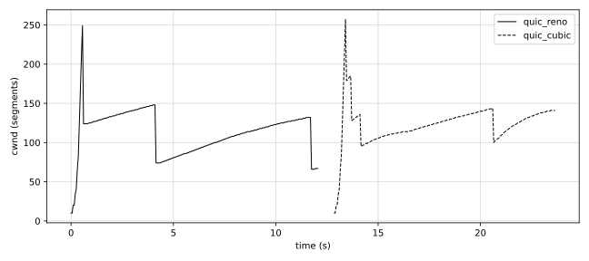
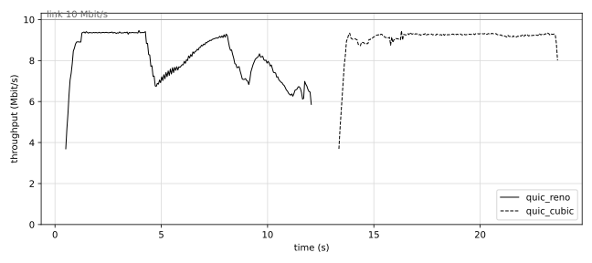

# QUIC: a reliable transport on top of UDP

Kurose & Ross, Ch. 3: Sec. 3.8 (QUIC).

TCP lives in the kernel of the operating system: to change it, the whole Internet must update its kernels. QUIC (Google 2012, IETF standard [RFC 9000](https://www.rfc-editor.org/rfc/rfc9000) in 2021, the transport of HTTP/3) takes another way: it sends **UDP** datagrams, and does everything else **inside the program**, as a library.

| | TCP | QUIC |
|---|---|---|
| where it runs | kernel | user space, inside the program (here: the Python library `aioquic`) |
| below it | IP | UDP |
| reliability, retransmissions | yes | yes, done by QUIC |
| congestion control | yes (Reno, Cubic, BBR in the kernel) | yes, done by QUIC (here Reno or Cubic, written in Python) |
| what names a connection | IP address and port of both ends | a **Connection ID**, written in each packet |
| set-up before the first data | 1 RTT (three-way handshake) | 1 RTT, encryption included |
| several flows in one connection | no: one byte stream | yes: many independent **streams** |

QUIC always encrypts. We do not study encryption here: the server uses a certificate made with one command, the client does not check it, and we look only at the transport.

---

## Files

| File | What it does |
|---|---|
| `quic_server.py` | receives a file on **UDP** port 12000 and saves it as `received.bin` |
| `quic_client.py` | sends a file over one QUIC stream; every 0.05 s saves `time,cwnd,ssthresh,rtt,bytes` in a CSV file |

The client writes the **same CSV format** as `cwnd_client.py` of [09_CONGESTION_CTL](../../09_CONGESTION_CTL/): we reuse its channel and its plot scripts.

The client takes three arguments: `python quic_client.py FILE ALGORITHM CSV`, with `ALGORITHM` = `reno` or `cubic` (the congestion control of QUIC).

Output columns: `time` = absolute time, `cwnd` and `ssthresh` in QUIC packets (1200 bytes of UDP payload each), `rtt` = smoothed RTT in ms, `bytes` = bytes of the file acked by the server so far, also the ones acked out of order (behind a lost packet).

The scripts use `asyncio`, the Python way to wait for several things at the same time. A QUIC program must wait for packets, for its timers (retransmissions, delayed ACKs, pacing) and, in the client, for the next 50 ms sample: `async def` marks a function that waits, `await` is the point where it waits and lets the rest work (`await asyncio.sleep(0.05)` = "wait 50 ms, and meanwhile let QUIC send and receive"), `asyncio.run(main())` starts it. `aioquic` uses `asyncio` to read the UDP socket and to run the timers for us.

How the client reads the congestion window: with TCP we had to ask the kernel (`getsockopt(TCP_INFO)`). QUIC runs in our own program, so the client simply reads the variables of `aioquic` (`quic._loss.congestion_window`, `quic._loss._rtt_smoothed`).

---

## Setup

`aioquic` is installed with the course environment ([00_PYTHON_ENVIRONMENT_SETUP](../../00_PYTHON_ENVIRONMENT_SETUP/)); by hand: `pip install aioquic`.

Make the certificate of the server, once (QUIC always encrypts; copy the command as it is):
```bash
openssl req -x509 -newkey rsa:2048 -nodes -keyout key.pem -out cert.pem -days 365 -subj /CN=localhost
```

Open two terminals in this folder: one for the **server**, one for the **client**.

Start `quic_server.py` in the server terminal. Leave it running for all the exercises. It prints:
```
listening on 127.0.0.1:12000 (UDP)
```

Start the channel of lab 09 in the client terminal (Linux / WSL):
```bash
../../09_CONGESTION_CTL/emulate_channel.sh start
```
The emulator selects the packets by port number (12000), not by protocol: it works for UDP too. Default channel: 10 Mbit/s link, router queue of 50 packets, RTT ≈ 100 ms. `DELAY`, `LOSS`, `QUEUE`, `RATE` work as in lab 09.

Make a test file of 12 MB with random bytes:
```bash
head -c 12000000 /dev/urandom > file.bin
```

---

## 1. Send a file

**Step 1.** Start in the client terminal:
```bash
python quic_client.py file.bin reno quic.csv
```

**Step 2.** Read the first line:
```
connected in 114 ms
```
The connection is ready after **1 RTT** (≈ 100 ms): in that single round trip QUIC sets up the transport and the encryption together.

**Step 3.** Wait for the end (≈ 11 s). The client prints the time and the throughput, the server what it received:
```
12000000 bytes in 12.1 s (7.93 Mbit/s), samples in quic.csv
```
```
received 12000000 bytes, saved in received.bin
```

**Step 4.** Check that the file arrived exactly, byte by byte:
```bash
cmp file.bin received.bin && echo identical
```
UDP alone loses packets and can change their order; the emulator also drops packets when its queue is full. The file is still identical: **QUIC** found the losses and retransmitted, not UDP.

---

## 2. Congestion control of QUIC

**Step 1.** Send the file with each algorithm, one run after the other:
```bash
python quic_client.py file.bin reno  quic_reno.csv
python quic_client.py file.bin cubic quic_cubic.csv
```

**Step 2.** Plot with the scripts of lab 09:
```bash
python ../../09_CONGESTION_CTL/plot_cwnd.py quic_reno.csv quic_cubic.csv --out quic_cwnd.png
python ../../09_CONGESTION_CTL/plot_thr.py  quic_reno.csv quic_cubic.csv --link 10 --out quic_thr.png
```

Real run (Linux, default channel):





What to find in the plots:
- The **same shapes as TCP** in lab 09: slow start, then Reno halves at each loss (here 148 → 74) and grows by 1 packet per RTT; Cubic falls to ≈ 0.7 and climbs back along its curve. QUIC uses the same algorithms ([RFC 9002](https://www.rfc-editor.org/rfc/rfc9002)), only written inside the program instead of the kernel.
- The throughput stays at ≈ 9.3 Mbit/s, a little less than the 9.38 of TCP. Each QUIC packet is 1242 bytes on the link (1200 of UDP payload + 8 UDP + 20 IP + 14 Ethernet), and inside the 1200 there are the QUIC header, the stream frame header and 16 bytes of the integrity tag of the encryption: ≈ 1160 bytes of the file per packet.
- The throughput never goes above the link. To measure it right, `bytes` counts **all** the acked bytes, also those that arrived after a lost packet: QUIC ACKs list the ranges of packets received, like TCP SACK. Counting only the bytes in order, all the bytes waiting behind a loss would count at the same moment, when the retransmission arrives, and the plot would show false peaks above 10 Mbit/s.

**Step 3.** Compare with TCP: run `cwnd_client.py` of lab 09 on the same channel and put the CSV files in the same plot, e.g. `plot_cwnd.py quic_reno.csv ../../09_CONGESTION_CTL/reno.csv`.

---

## 3. Random loss (optional)

**Step 1.** Activate 1 % random loss: `LOSS=1% ../../09_CONGESTION_CTL/emulate_channel.sh start`.

**Step 2.** Repeat exercise 2 with `quic_reno_loss1.csv` and `quic_cubic_loss1.csv` as CSV files, and check again with `cmp` that the file is identical.

What to find: the transfer is slower (each loss is read as congestion, as in TCP), but the file is still identical.

**Step 3.** Back to the default channel: `../../09_CONGESTION_CTL/emulate_channel.sh start`. At the end of the lab: `../../09_CONGESTION_CTL/emulate_channel.sh stop`.

---

## References

For the curious, to study the details:
- [RFC 9000](https://www.rfc-editor.org/rfc/rfc9000): QUIC, the transport
- [RFC 9002](https://www.rfc-editor.org/rfc/rfc9002): QUIC loss detection and congestion control
- [aioquic](https://github.com/aiortc/aioquic): the Python library used here
