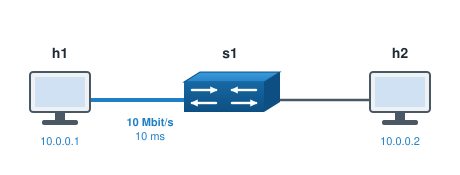

# Containernet on Ubuntu 26.04

Installation guide for [Containernet](https://containernet.github.io/) on **Ubuntu 26.04 LTS**. Containernet officially supports only Ubuntu 22.04 and 24.04: the patch in this folder adds 26.04 support.

## Requirements

- Ubuntu 26.04 LTS (the Server edition is fine), with a user that can run `sudo`
- at least 2 CPUs, 4 GB of RAM and 30 GB of disk

## Installation

### 1. conda

conda must be installed as in [00_PYTHON_ENVIRONMENT_SETUP](../../00_PYTHON_ENVIRONMENT_SETUP), Step 1. Check:

```bash
conda --version
```

### 2. Create the conda environment `cn`

```bash
conda create -n cn python=3.14 -y
conda activate cn
```

Keep this terminal open: all the next steps run in it, with `cn` active.

### 3. Base packages

```bash
sudo apt-get update
sudo apt-get install -y git ansible
```

### 4. Download Containernet and apply the patch

```bash
cd ~
curl -fsSLO https://raw.githubusercontent.com/fabriziogiuliano/reti_calcolatori/main/12_CONTAINERNET/12_0_INSTALL/containernet-ubuntu-26.04.patch
git clone https://github.com/containernet/containernet.git
cd ~/containernet
git checkout 8e0aabef8f23def3961b30897dd486191d9bd693
git apply --check ~/containernet-ubuntu-26.04.patch
git apply ~/containernet-ubuntu-26.04.patch
```

`git apply --check` must print nothing. If it prints an error, do not continue.

### 5. Install the system dependencies with Ansible

```bash
cd ~
sudo ansible-playbook -i "localhost," -c local containernet/ansible/install.yml
```

This installs Docker CE, Open vSwitch, the Mininet dependencies and the OpenFlow controller. It takes several minutes.

If it stops and you need to run it again, first delete the directory created by the installer: `sudo rm -rf ~/openflow`.

### 6. Install Containernet in `cn`

```bash
cd ~/containernet
pip install .
```

### 7. Check

```bash
sudo "$CONDA_PREFIX/bin/mn" --test pingall
```

It builds a tiny network (two hosts and a switch), pings between the hosts and exits. The output should contain `*** Results: 0% dropped (2/2 received)`.

## Running scripts

In every new terminal:

```bash
conda activate cn
sudo "$CONDA_PREFIX/bin/python" your_script.py
```

`sudo` is needed to create the virtual hosts, switches and links; `$CONDA_PREFIX/bin/python` is the Python of `cn`, which `sudo` would not find by itself.

## Your first script, step by step

Once the check of step 7 works, build a small network yourself: two hosts and one switch, **without a controller**. The first try fails: you will see why, and fix it by changing one line.



### Background

**Mininet** emulates a network inside one Linux machine. A host is a shell with its own interfaces, IP addresses and routing table; a switch is a virtual switch (Open vSwitch); a link is a virtual Ethernet cable, and with `TCLink` you choose its bandwidth and delay. **Containernet** is Mininet plus **Docker containers** as hosts (`addDocker`); the Python API is the same. Here we only use Mininet hosts.

**Who fills the table of the switch?** A router forwards with its forwarding table (destination → output port). A switch has a table too. A normal switch fills it by itself; the default switch of Mininet waits for an external program, a **controller**, to fill it. Without a controller the table stays empty, and the switch drops every packet.

### Step 1. Imports

Create a file, e.g. `your_script.py`, and write:

```python
from mininet.net import Containernet
from mininet.link import TCLink
from mininet.cli import CLI
from mininet.log import setLogLevel

setLogLevel('info')
```

`setLogLevel('info')` makes Mininet print what it is doing (`*** Adding hosts`, ...).

### Step 2. The network

```python
net = Containernet(controller=None)
```

`net` holds every node and link. `controller=None`: no controller. Without it, `net.start()` adds a default controller by itself and the ping would work at once.

### Step 3. Two hosts

```python
h1 = net.addHost('h1', ip='10.0.0.1')
h2 = net.addHost('h2', ip='10.0.0.2')
```

### Step 4. A switch

```python
s1 = net.addSwitch('s1')
```

### Step 5. The links

```python
net.addLink(h1, s1, cls=TCLink, bw=10, delay='10ms')
net.addLink(h2, s1)
```

`cls` stands for *class* (`class` is a reserved word in Python): it chooses the type of link. By default a link is a plain cable; `TCLink` is a link with limits, and accepts the bandwidth (`bw`, in Mbit/s) and the delay of that link. `bw` and `delay` work only with `cls=TCLink`. The link `h2`–`s1` has no `cls`, so it is a plain cable.

### Step 6. Start, CLI, stop

```python
net.start()
CLI(net)
net.stop()
```

`net.start()` creates switch and links. `CLI(net)` opens the `containernet>` prompt and waits until you type `exit`; then `net.stop()` deletes everything.

### Step 7. Run it: the ping fails

```bash
conda activate cn
sudo "$CONDA_PREFIX/bin/python" your_script.py
```

At the prompt:

```
containernet> net
containernet> h1 ping -c3 h2
```

`net` shows the links. The ping fails with `100% packet loss`: there is no controller, the table of `s1` stays empty and `s1` drops every packet.

### Step 8. Fix: change the switch

Leave the CLI with `exit`, then change the switch line and add one import:

```python
from mininet.node import OVSBridge

s1 = net.addSwitch('s1', cls=OVSBridge)
```

The same `cls` as for the links: here it chooses the type of switch, instead of the default one that waits for a controller. `OVSBridge` is a switch that works on its own, without a controller. More in the next labs.

### Step 9. Check

Run the script again. At the prompt:

```
containernet> h1 ping -c3 h2
```

The ping works (`0% packet loss`), with a time of about 20 ms: the 10 ms of the link `h1`–`s1`, once in each direction.

Next: [12_1](../12_1_PERFORMANCE) measures this kind of network with ping and iperf; [12_2](../12_2_SIMPLE_OVS_CONF) goes back to the switch with the empty table, and fills it by hand.

### Clean up

If the script stops in the middle (Ctrl+C, closed terminal), the next run fails with `File exists`. Clean everything with:

```bash
sudo "$CONDA_PREFIX/bin/mn" -c
```
