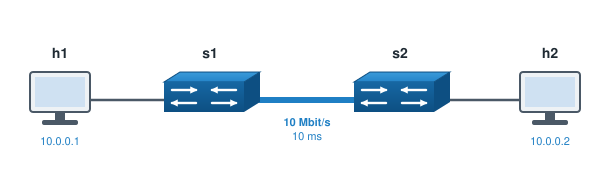
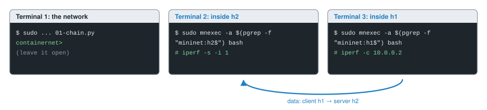
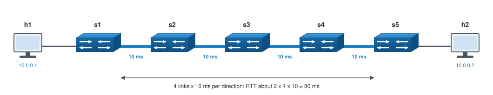
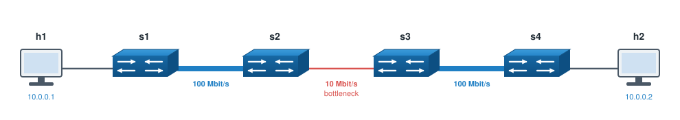
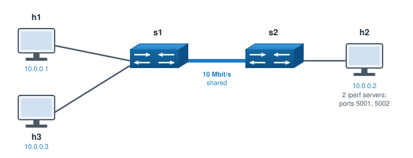
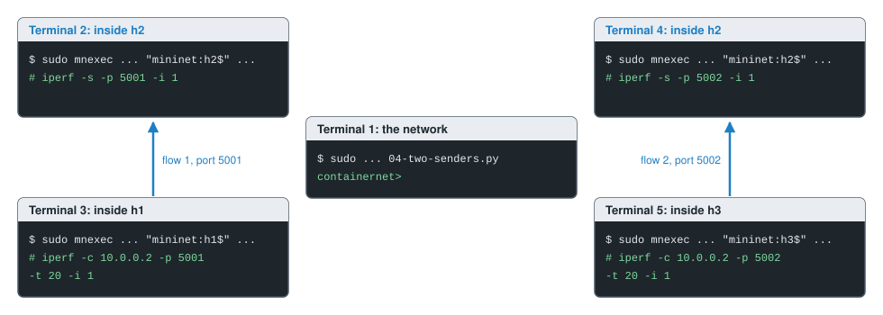

# 12.1 Network performance: ping and iperf

Kurose & Ross: Ch. 1, Sec. 1.4 (delay, loss, throughput).

Small networks of hosts and switches, with links of known bandwidth and delay. You measure them with two tools: **ping** (delay and loss) and **iperf** (throughput). The switches are the ones that work on their own (`OVSBridge`, seen at the end of [12_0_INSTALL](../12_0_INSTALL)): here we do not look inside them. To change the network you **edit the scripts by hand**.

Containernet must be installed as in [12_0_INSTALL](../12_0_INSTALL).

## Background

| Quantity | What it is | Tool |
|---|---|---|
| **RTT** (round-trip time) | time for a packet to go and for the answer to come back | `ping` |
| **loss** | fraction of packets that never arrive | `ping`, `iperf -u` |
| **throughput** | bits per second actually delivered to the receiver | `iperf` |

- The **delay** of a link is paid once per direction, and the delays of links in cascade **add up**: with L links of 10 ms, the RTT is about **2 × L × 10 ms**, plus a little processing time of your machine.
- The **throughput** of a path is limited by its slowest link, the **bottleneck**: throughput ≈ min(bandwidth of the links), a bit less because of the headers.
- The **loss** of a `TCLink` applies to each direction: a ping is lost if the request *or* the reply is lost. With `loss=1` on one link, about 2%.

### iperf

**iperf** measures throughput. It is two programs talking to each other:

- the **server** waits for data and counts what arrives: `iperf -s`
- the **client** sends data to the server as fast as it can: `iperf -c <server IP>`

By default it uses **TCP**, on port 5001, for 10 seconds. The options used here:

| Option | Meaning |
|---|---|
| `-s` | server |
| `-c 10.0.0.2` | client, sending to `10.0.0.2` |
| `-i 1` | print a report every second |
| `-t 10` | send for 10 seconds |
| `-u` | UDP instead of TCP (on both server and client) |
| `-b 5M` | UDP only: send at 5 Mbit/s |
| `-p 5002` | use port 5002 instead of 5001 (on both server and client) |

These are the commands of **iperf 2** (`iperf --version`), not iperf3. If it is missing: `sudo apt install iperf`.

## Files

| File | Network |
|---|---|
| `01-chain.py` | `h1 – s1 – s2 – h2`, link `s1`–`s2` at 10 Mbit/s, 10 ms |
| `02-cascade.py` | five switches in cascade, four links of 10 Mbit/s, 10 ms |
| `03-bottleneck.py` | four switches, links at 100, **10**, 100 Mbit/s |
| `04-two-senders.py` | `h1` and `h3` send to `h2` through the same 10 Mbit/s link |

Only the links between switches are `TCLink`; the links of the hosts have no limits.

## Run

### 1. Start the network (terminal 1)



From this folder, `12_CONTAINERNET/12_1_PERFORMANCE`:

```bash
conda activate cn
sudo "$CONDA_PREFIX/bin/python" 01-chain.py
```

The `containernet>` prompt opens: leave this terminal open, the network lives as long as the CLI.

### 2. One terminal per host, with `mnexec`

To run iperf you need two programs at the same time: the server on `h2` and the client on `h1`. So open **two more terminals**: one becomes `h2`, the other `h1`.



Every Mininet host is a shell (`bash ... mininet:h1`) in its own **network namespace**: its own interfaces, IP addresses and routing table. `mnexec -a <PID>` runs a command inside the namespace of the process `<PID>`, and `pgrep -f "mininet:h1$"` finds the PID of the shell of `h1`.

**Terminal 2**, becomes `h2`:

```bash
sudo mnexec -a $(pgrep -f "mininet:h2$") bash
```

**Terminal 3**, becomes `h1`:

```bash
sudo mnexec -a $(pgrep -f "mininet:h1$") bash
```

The prompt becomes `root@...`, the same in both: check where you are with

```bash
ip addr
```

In terminal 3 you see `h1-eth0` with `10.0.0.1`, in terminal 2 `h2-eth0` with `10.0.0.2`. Leave a host with `exit`.

- The `$` at the end of `"mininet:h1$"` is needed: without it, `h1` would also match `h10`, `h11`, ...
- Only the network is the one of the host: the files and the processes are those of your machine.
- With **tmux**, the three terminals fit in one window: `tmux`, then `Ctrl+b %` (split left/right), `Ctrl+b "` (split top/bottom), `Ctrl+b` + arrow to move.

### 3. Ping: RTT and loss

In terminal 3 (`h1`):

```bash
ping -c 10 10.0.0.2
```

The RTT is about **20 ms**. The first ping is often slower: before it, `h1` must find the MAC address of `h2`, and the switches must learn where `h2` is. The last line summarizes min/avg/max of the RTT and the loss (`0% packet loss`).

### 4. iperf TCP: throughput

Terminal 2 (`h2`), the server:

```bash
iperf -s -i 1
```

Terminal 3 (`h1`), the client:

```bash
iperf -c 10.0.0.2 -t 10 -i 1
```

Every second the client prints a line like

```
[  1] 2.0000-3.0000 sec  1.12 MBytes  9.44 Mbits/sec
```

interval, data sent in that interval, throughput. The last line is the average over the whole test: about **9.5 Mbit/s**, a bit less than the 10 Mbit/s of the link. The server prints the same numbers from its side. Stop the server with Ctrl+C when you change test.

### 5. Change the link by hand and measure again

In `01-chain.py`, change the line of the link `s1`–`s2`:

```python
net.addLink(s1, s2, cls=TCLink, bw=10, delay='10ms')
```

Leave the CLI (`exit` in terminal 1; terminals 2 and 3 lose their host, `exit` there too), run the script again and repeat steps 2–4. Before measuring, **predict** the result.

| Change | Predict the RTT | Predict the TCP throughput |
|---|---|---|
| `bw=5` | | |
| `bw=50` | | |
| `delay='50ms'` | | |
| add `loss=1` | | |

What you should see:

- **bw** changes the throughput, not the RTT of a ping (a ping packet is small).
- **delay** changes the RTT; TCP needs a few seconds more to reach the full speed (look at the first lines of `-i 1`).
- **loss**: ping loses about 2% of the packets, but the TCP throughput falls much more than 1%: TCP takes every loss as a sign of congestion and slows down. Why, in detail: [09_CONGESTION_CTL](../../09_CONGESTION_CTL/), [10_PERFORMANCE_IPERF](../../10_PERFORMANCE_IPERF/).

### 6. iperf UDP: send faster than the link

UDP has no congestion control: iperf sends at the rate you ask with `-b`, and what does not fit is lost. Use `01-chain.py` with `bw=10`.

Terminal 2 (`h2`):

```bash
iperf -s -u -i 1
```

Terminal 3 (`h1`), first below, then above the link speed:

```bash
iperf -c 10.0.0.2 -u -b 5M -t 10 -i 1
iperf -c 10.0.0.2 -u -b 20M -t 10 -i 1
```

Read the **server** report: the column `Lost/Total Datagrams`. At 5 Mbit/s almost nothing is lost; at 20 Mbit/s the server receives about 10 Mbit/s and about **half** of the datagrams are lost. The client does not know: it reports the rate at which it *sent*.

### 7. Switches in cascade: the delay adds up



```bash
sudo "$CONDA_PREFIX/bin/python" 02-cascade.py
```

Four links of 10 ms: measure the RTT (step 3) and the TCP throughput (step 4).

| Links of 10 ms | Predicted RTT | Measured RTT | TCP throughput |
|---|---|---|---|
| 1 (`01-chain.py`) | 20 ms | | |
| 4 (`02-cascade.py`) | 80 ms | | |

The RTT grows with the number of links; the throughput stays at about 10 Mbit/s: every link is a 10 Mbit/s link, and a chain of them is as fast as one of them. Try: remove `s5` and its links, or add `s6`.

### 8. The bottleneck



```bash
sudo "$CONDA_PREFIX/bin/python" 03-bottleneck.py
```

All links at 100 Mbit/s, except one at 10 Mbit/s. TCP throughput: about **10 Mbit/s**, not 100: the slowest link decides. Try `bw=50` and `bw=2` on the line `# the bottleneck`, then all at 100.

### 9. Two flows share the bottleneck



```bash
sudo "$CONDA_PREFIX/bin/python" 04-two-senders.py
```

One iperf server serves one client at a time: with a single server, the second client would wait until the first one ends. So `h2` runs **two servers, on two ports**, each in its own terminal, and each client talks to its own port. Five terminals:



Terminals 2 and 4 both enter `h2`; terminal 3 enters `h1`, terminal 5 enters `h3`:

```bash
sudo mnexec -a $(pgrep -f "mininet:h2$") bash     # terminals 2 and 4
sudo mnexec -a $(pgrep -f "mininet:h1$") bash     # terminal 3
sudo mnexec -a $(pgrep -f "mininet:h3$") bash     # terminal 5
```

The two servers:

```bash
iperf -s -p 5001 -i 1      # terminal 2 (h2)
iperf -s -p 5002 -i 1      # terminal 4 (h2)
```

The two clients, started at the same time, for 20 seconds:

```bash
iperf -c 10.0.0.2 -p 5001 -t 20 -i 1      # terminal 3 (h1)
iperf -c 10.0.0.2 -p 5002 -t 20 -i 1      # terminal 5 (h3)
```

While both run, each gets about **half** of the 10 Mbit/s, and the sum stays at about 10 Mbit/s. If one starts a few seconds later, look at its first lines: the other one slows down to make room. TCP shares the bottleneck among the flows; not exactly half and half, but close.

### Clean up

If a script stops in the middle (Ctrl+C, closed terminal), the next run fails with `File exists`. Clean everything with:

```bash
sudo "$CONDA_PREFIX/bin/mn" -c
```
