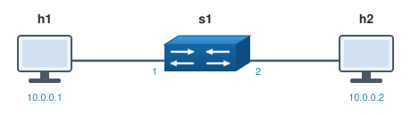

# 12.1 Simple topology

Two hosts and one OpenFlow switch:





Containernet must be installed as in [12_0_INSTALL](../12_0_INSTALL).

## Files

| File | What it does |
|---|---|
| `01-simple_topology.py` | starts the network with an empty switch and no controller: the ping **fails** |
| `01b-simple_topology.py` | same network, but the flow rules are written into `s1` by hand: the ping **works** |

## Run

Run the commands from this folder, `12_CONTAINERNET/12_1_SIMPLE_TOPOLOGY`, with the environment `cn` active:

```bash
conda activate cn
```

### 1. Switch without rules

```bash
sudo "$CONDA_PREFIX/bin/python" 01-simple_topology.py
```

The script pings `h2` from `h1` once. The switch has no flow rules and no controller answers on `127.0.0.1:6653`, so the packet is dropped:

```
1 packets transmitted, 0 received, 100% packet loss
```

Then the Mininet CLI opens. Leave it with `exit` (or Ctrl+D).

### 2. Rules written by hand

```bash
sudo "$CONDA_PREFIX/bin/python" 01b-simple_topology.py
```

Before the CLI opens, the script adds four rules to `s1` with `dpctl`: ARP from port 1 to port 2 and back, and IP packets to the port of their destination. At the `mininet>` prompt:

```
mininet> h1 ping -c3 h2
mininet> sh ovs-ofctl dump-flows s1
```

The ping works, and `dump-flows` shows the four rules with their packet counters (`n_packets`).

## Enter a host with `mnexec`

Every Mininet host is a shell (`bash ... mininet:h1`) running in its own **network namespace**: its own interfaces, IP addresses and routing table. `mnexec -a <PID>` runs a command inside the network (and mount) namespace of the process `<PID>`, and `pgrep -f "mininet:h1$"` finds the PID of the shell of `h1`.

Keep the network running (CLI open) and, in a **second terminal**, open a shell inside `h1` in one go:

```bash
sudo mnexec -a $(pgrep -f "mininet:h1$") bash
```

The prompt becomes `root@...`: you are now inside `h1`. Check it:

```bash
ip addr
```

**Expected output**
```
1: lo: <LOOPBACK,UP,LOWER_UP> mtu 65536 qdisc noqueue state UNKNOWN group default qlen 1000
    link/loopback 00:00:00:00:00:00 brd 00:00:00:00:00:00
    inet 127.0.0.1/8 scope host lo
       valid_lft forever preferred_lft forever
    inet6 ::1/128 scope host proto kernel_lo
       valid_lft forever preferred_lft forever
576: h1-eth0@if575: <BROADCAST,MULTICAST,UP,LOWER_UP> mtu 1500 qdisc noqueue state UP group default qlen 1000
    link/ether 00:00:00:00:00:01 brd ff:ff:ff:ff:ff:ff link-netnsid 0
    inet 10.0.0.1/8 scope global h1-eth0
       valid_lft forever preferred_lft forever
```

Only `lo` and `h1-eth0`, with the IP and the MAC of `h1`. The interface numbers (`576`, `575`) may be different. Leave with `exit`.

For `h2`, change the name:

```bash
sudo mnexec -a $(pgrep -f "mininet:h2$") bash
```

The `$` at the end of `"mininet:h1$"` is needed: without it, `h1` would also match `h10`, `h11`, ...

Only the network and the file system are those of the host: `ps` still shows all the processes of the machine.

For a Docker host of Containernet (added with `addDocker`, e.g. `d1`) use Docker instead: `sudo docker exec -it mn.d1 bash`.
