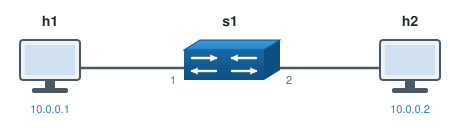

# 12.2 Simple OVS configuration

Two hosts and one switch:





Containernet must be installed as in [12_0_INSTALL](../12_0_INSTALL).

In [12_0_INSTALL](../12_0_INSTALL) ("Your first script, step by step") the ping between `h1` and `h2` failed: without a controller nobody fills the table of the switch, and the switch drops every packet. There we replaced the switch with one that works on its own. Here we keep the default switch and **fill its table by hand**.

## Files

| File | What it does |
|---|---|
| `01-simple_topology.py` | the starting point: no controller, empty table, the ping **fails** (as in 12_0) |
| `01b-simple_topology.py` | same network, but the flow rules are written into `s1` by hand: the ping **works** |

## Run

Run the commands from this folder, `12_CONTAINERNET/12_2_SIMPLE_OVS_CONF`, with the environment `cn` active:

```bash
conda activate cn
```

### 1. Starting point: empty table

Quick recap of 12_0, with the default switch:

```bash
sudo "$CONDA_PREFIX/bin/python" 01-simple_topology.py
```

The script pings `h2` from `h1` once: `100% packet loss`. At the `containernet>` prompt, look at the table of `s1`:

```
containernet> sh ovs-ofctl dump-flows s1
```

It prints no rules. Leave with `exit` (or Ctrl+D).

### 2. Rules written by hand

```bash
sudo "$CONDA_PREFIX/bin/python" 01b-simple_topology.py
```

Before the CLI opens, the script adds four rules to `s1` with `dpctl`: ARP from port 1 to port 2 and back, and IP packets to the port of their destination. At the `containernet>` prompt:

```
containernet> h1 ping -c3 h2
containernet> sh ovs-ofctl dump-flows s1
```

The ping works, and `dump-flows` shows the four rules with their packet counters (`n_packets`).

## Enter a host

To open a shell inside `h1` or `h2` from another terminal, use `mnexec` as in [12_1_PERFORMANCE](../12_1_PERFORMANCE/README.md#2-one-window-per-host-with-mnexec).
