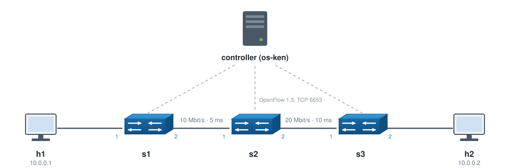
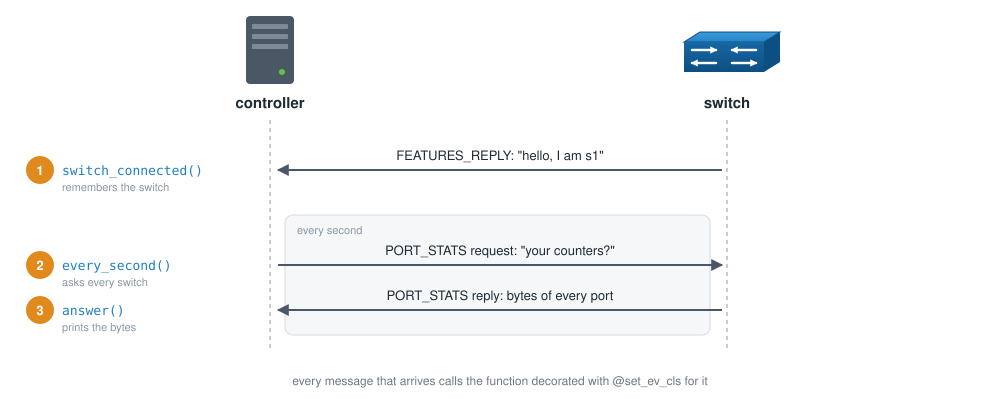
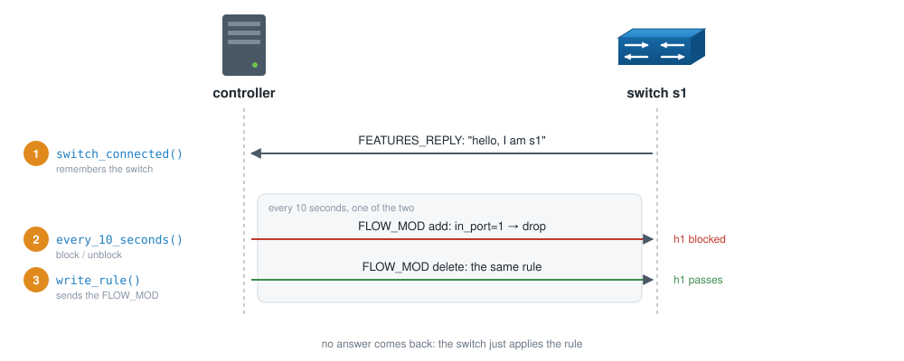
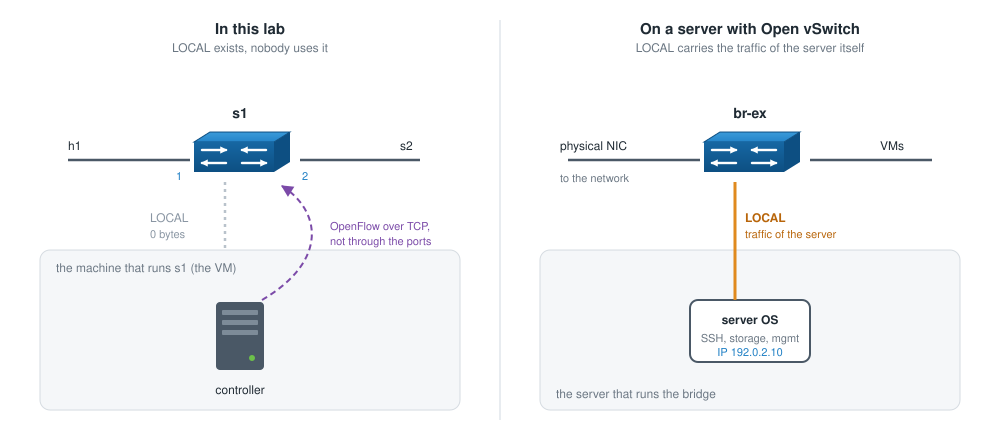

# 12.2 Template controller

Two minimal SDN controllers written with os-ken: one **reads** from the switches, one **writes** into them. They are the pieces you need to build any tool; in [12_3_MONITORING](../12_3_MONITORING/) they become a real one.



The switches forward the packets by themselves (rule `actions=normal`, written by `topology.py`): the controller only talks with them.

| File | What it is |
|---|---|
| `template_read.py` | every second, asks the switches their port counters |
| `template_write.py` | every 10 seconds, writes a rule into `s1` (or removes it) |
| `topology.py` | the network of the picture |
| `run_controller.py` | starts a controller |

Two terminals, both in this folder with `conda activate cn`:

```bash
python run_controller.py template_read                 # terminal 1 (or template_write)
sudo "$CONDA_PREFIX/bin/python" topology.py            # terminal 2
```

`@set_ev_cls(<message>, <phase>)` above a function says which message calls it.

## 1. Read: template_read.py



| Piece | Function | Called when |
|---|---|---|
| 1 | `switch_connected()` | a switch connects to the controller |
| 2 | `every_second()` | every second (a loop started in `__init__`) |
| 3 | `answer()` | the answer to the request of piece 2 arrives |

Terminal 1, every second:

```
s1 port 1: 180 bytes sent
s1 port 2: 180 bytes sent
```

- The bytes are a **total**: they grow only when there is traffic. Try `h1 ping -c3 h2` in terminal 2.
- The internal port of the switch is skipped: see below.

## 2. Write: template_write.py



| Piece | Function | Called when |
|---|---|---|
| 1 | `switch_connected()` | a switch connects to the controller |
| 2 | `every_10_seconds()` | every 10 seconds: block or unblock `h1` |
| 3 | `write_rule()` | sends the `FLOW_MOD` to `s1` |

The rule: `in_port=1` (what enters `s1` from `h1`), no actions (= drop), priority 100 (wins over the normal forwarding, priority 0).

Run `h1 ping h2` in terminal 2. Real output:

```
s1: rule written, drop what comes from h1        ← ping stops
s1: rule removed, h1 passes again                ← ping starts again
```

```
32 packets transmitted, 14 received, 56.25% packet loss
```

The ping goes through and stops in turns, every 10 seconds. Check the rule while it is there: `sh ovs-ofctl -O OpenFlow13 dump-flows s1`.

## The internal port (LOCAL)

Port `4294967294` (`0xfffffffe`, `OFPP_LOCAL`) connects the switch to the machine it runs on. It is not a cable.



**Here we skip it:** the controller talks with the switches over TCP, outside the switch ports, and no host uses the internal port. Its counters are always 0 and say nothing about the traffic of the network.

**Sometimes it is useful:**

- on servers with Open vSwitch (cloud, virtualization), the IP address of the server is on the internal port of the bridge: all the traffic of the server itself goes through it (e.g. VirtualBox, bridged mode);
- with *in-band* control, the messages between switch and controller travel on the data network and leave the switch from this port;
- a rule with action `output:LOCAL` delivers packets to the machine of the switch.

## Exercise

1. `template_read.py`: print also the received bytes (`port.rx_bytes`).
2. `template_read.py`: ask every 5 seconds instead of every second.
3. `template_write.py`: block only the ping (`eth_type=0x0800, ip_proto=1`), not all the traffic of `h1`.
4. `template_write.py`: block `h2` on `s3` instead of `h1` on `s1`.
