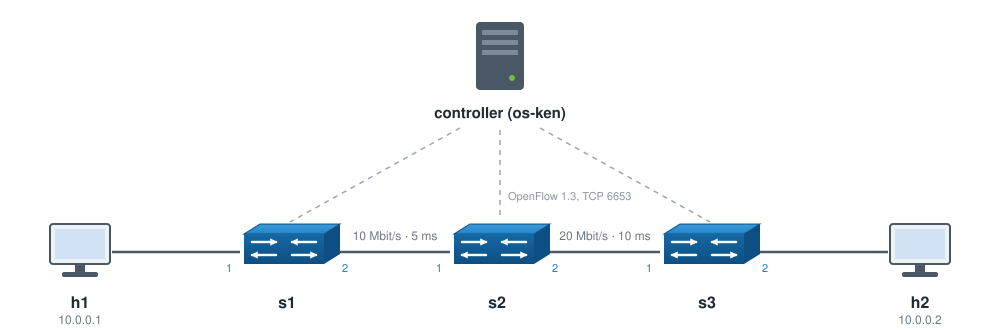
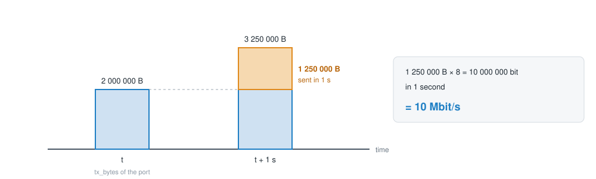
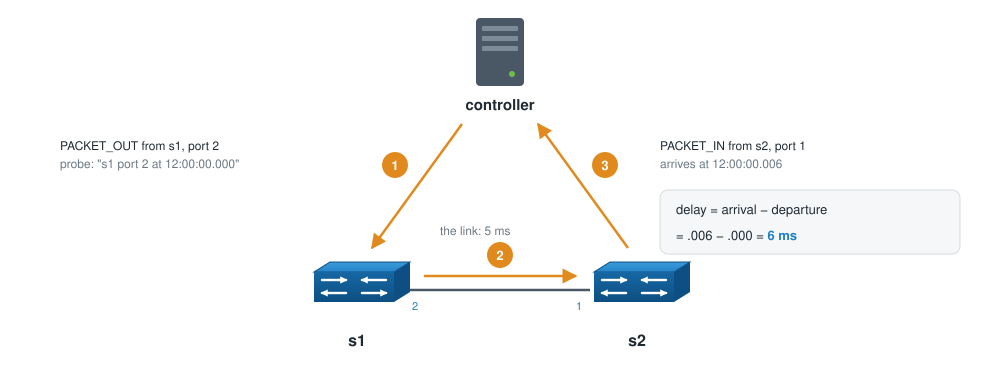

# 12.3 Monitoring

The [template](../12_2_TEMPLATE_CONTROLLER/) becomes a tool: every second the controller measures the **bandwidth** of every port and the **delay** of every link.



| File | What it is |
|---|---|
| `monitor_bandwidth.py` | bandwidth of every port |
| `monitor_delay.py` | delay of every link |
| `monitor_full.py` | both, in one table (to read after the other two) |
| `monitor_topology.py` | the network of the picture |
| `run_controller.py` | starts the controller |

Two terminals, both in this folder with `conda activate cn`:

```bash
python run_controller.py monitor_bandwidth             # terminal 1 (or monitor_delay)
sudo "$CONDA_PREFIX/bin/python" monitor_topology.py    # terminal 2
```

## 1. Bandwidth



The switch counts the bytes sent by every port. Two samples, one second apart: the difference is what the port sent in that second.

What changes from the template, in piece 3:

```python
sent = port.tx_bytes - self.last_bytes.get(key, port.tx_bytes)
self.last_bytes[key] = port.tx_bytes
print('s%d port %d: %.2f Mbit/s' % (key[0], key[1], sent * 8 / 1e6))
```

At rest everything is `0.00`. With traffic (`h2 iperf -s &`, then `h1 iperf -c h2 -t 20`), real output:

```
s1 port 1: 0.15 Mbit/s
s1 port 2: 9.70 Mbit/s
s2 port 1: 0.15 Mbit/s
s2 port 2: 9.70 Mbit/s
s3 port 1: 0.15 Mbit/s
s3 port 2: 9.70 Mbit/s
```

- **9.70 Mbit/s** on every port towards `h2`: the slowest link (10 Mbit/s, `s1`–`s2`) limits the whole path.
- **0.15 Mbit/s** towards `h1`: the TCP ACKs.

## 2. Delay



The controller sends a probe out of a port, with the time written inside. The switch on the other side gives it back to the controller.

What is added to the template:

| Piece | Code | Why |
|---|---|---|
| a rule | `OFPFlowMod`, match `eth_type=0x88b5` → controller | the switch gives the probes back |
| send | `OFPPacketOut` out of port 1 and 2, every second | the probe leaves |
| receive | `EventOFPPacketIn` | the probe comes back: `delay = now - time in the probe` |

Real output at rest:

```
s1 port 2 -> s2 port 1: 5.7 ms
s2 port 2 -> s3 port 1: 10.7 ms
```

About 1 ms more than the link (5 ms, 10 ms): the trip from and to the controller.

**Try it with traffic.** Start `monitor_delay` and an `iperf` from `h1` to `h2`: the delay `s1 -> s2` grows to more than one second. The probe waits in the queue of the full link, behind the packets of iperf (bufferbloat).

## Notes

- Mininet prints `sch_htb: quantum of class ... is big` when it builds the links: harmless.
- After an interrupted run: `sudo "$CONDA_PREFIX/bin/mn" -c`.
