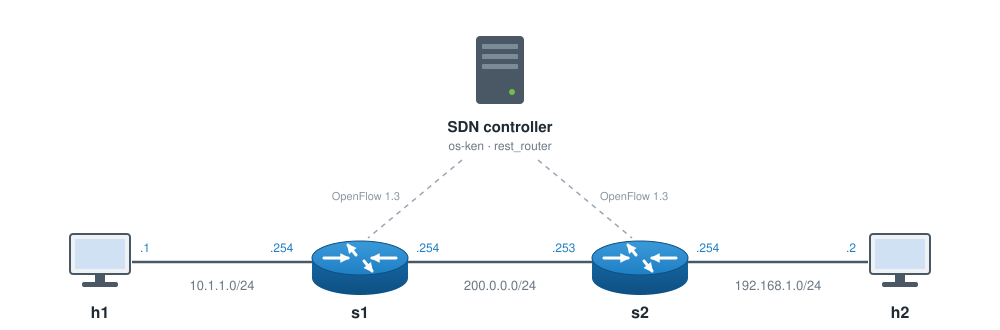

# 12.4 REST router: an SDN router configured via REST

Two OpenFlow switches become IPv4 routers; the routing logic runs in an [os-ken](https://opendev.org/openstack/os-ken) controller, configured at runtime with a REST API.



**Full documentation: [docs/](docs/README.md)** (concepts, step-by-step diagrams, flow rules, REST API, exercises).

## Quick start

Containernet installed as in [12_0_INSTALL](../12_0_INSTALL), then, once:

```bash
conda activate cn
pip install os-ken==4.2.2
```

From this folder, in two terminals with `cn` active:

```bash
python run_controller.py rest_router                    # terminal 1: the controller
sudo "$CONDA_PREFIX/bin/python" router_topology.py      # terminal 2: the network
```

At the `mininet>` prompt: `h1 ping -c3 h2`.

## Files

| File | What it is |
|---|---|
| `rest_router.py` | the controller application (the router) |
| `run_controller.py` | starts os-ken applications |
| `router_topology.py` | the network, configured via REST, then the Mininet CLI |
| `router_topology_iperf.py` | the same network, then 10 s of UDP iperf from `h2` to `h1` |
| `docs/` | the documentation |
