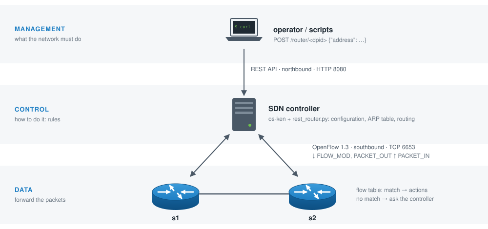
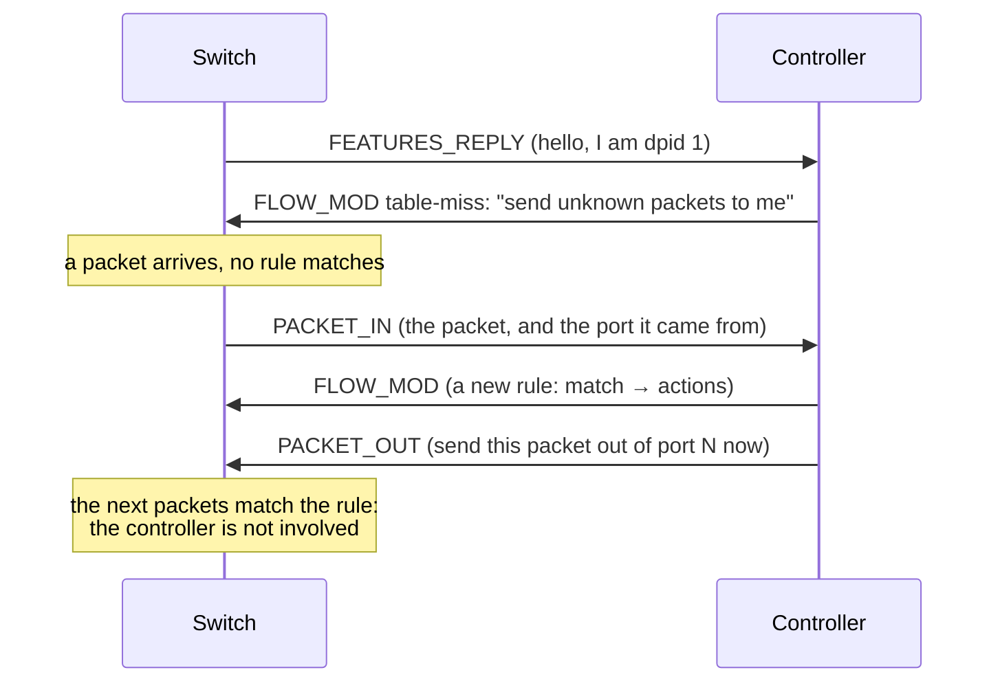

# 1. SDN in one picture

[← Home](README.md) · [Next: the lab topology →](02-topology.md)

## Three planes

A traditional router does everything inside one box: it forwards packets **and** decides how to forward them (routing protocols, ARP, configuration). **Software Defined Networking** (SDN) splits the two jobs:

| Plane | Who | Job | In this lab |
|---|---|---|---|
| **Data plane** | the switches | forward packets fast, following a table of rules | Open vSwitch `s1`, `s2` |
| **Control plane** | the controller | decide the rules and write them into the switches | `rest_router.py` on os-ken |
| **Management plane** | operators, programs | tell the controller *what* they want | `curl` to the REST API |

The switch is "dumb": it only knows **match → actions** rules. When a packet matches no rule, the switch asks the controller.

## OpenFlow: the language between controller and switch

The controller and the switches talk **OpenFlow** over TCP (port **6653**). The lab uses version **1.3**. Four messages are enough to understand the whole lab:

| Message | Direction | Meaning |
|---|---|---|
| `FEATURES_REPLY` | switch → controller | the switch connects and says who it is (its **dpid**, datapath id) |
| `PACKET_IN` | switch → controller | "I don't know what to do with this packet" |
| `FLOW_MOD` | controller → switch | add (or delete) a rule in the flow table |
| `PACKET_OUT` | controller → switch | "send this packet out of this port" |

## Reactive and proactive

- **Reactive**: the controller writes a rule when the first packet of a flow arrives (`PACKET_IN`). The first packet is slow, the next ones are fast.
- **Proactive**: the controller writes the rules in advance, when the switch connects.

`rest_router.py` is **reactive** for the routes: it learns where the hosts are from their traffic, and writes a rule for each destination the first time a packet goes there.

## Northbound and southbound

- **Southbound** API: controller ↔ switches. Here: OpenFlow.
- **Northbound** API: programs ↔ controller. Here: the REST API on port **8080**.

The northbound API is what makes SDN programmable: a script can reconfigure the whole network with a few HTTP requests, as [`router_topology.py`](../router_topology.py) does.
