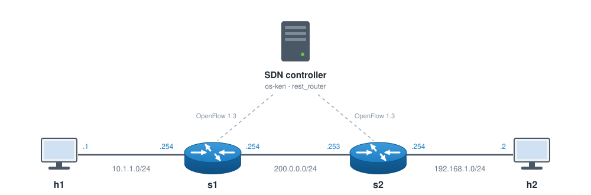

# 2. The lab topology

[← SDN in one picture](01-sdn-concepts.md) · [Home](README.md) · [Next: how the router works →](03-how-the-router-works.md)

Two hosts in two different subnets, two switches that act as routers, and a third subnet between the routers. Every link is 1 Mbit/s (`TCLink`), with 2 ms or 5 ms of delay.

## Addresses

| Node | Interface / port | IP address | MAC address | Set by |
|---|---|---|---|---|
| `h1` | `h1-eth0` | `10.1.1.1/24`, gateway `10.1.1.254` | `00:00:00:00:00:01` | the script (`addHost`, `ip route`) |
| `s1` | port 1 (to `h1`) | `10.1.1.254/24` | `02:00:00:00:00:01` | REST, `POST /router/0000000000000001` |
| `s1` | port 2 (to `s2`) | `200.0.0.254/24` | `02:00:00:00:00:01` | REST |
| `s2` | port 1 (to `s1`) | `200.0.0.253/24` | `02:00:00:00:00:02` | REST, `POST /router/0000000000000002` |
| `s2` | port 2 (to `h2`) | `192.168.1.254/24` | `02:00:00:00:00:02` | REST |
| `h2` | `h2-eth0` | `192.168.1.2/24`, gateway `192.168.1.254` | `00:00:00:00:00:02` | the script |

## Routes

| Router | Destination | Next hop | Why |
|---|---|---|---|
| `s1` | `10.1.1.0/24`, `200.0.0.0/24` | directly connected | it has an address in these subnets |
| `s1` | everything else (`0.0.0.0/0`) | `200.0.0.253` (`s2`) | default route, `{"gateway": "200.0.0.253"}` |
| `s2` | `200.0.0.0/24`, `192.168.1.0/24` | directly connected | |
| `s2` | everything else | `200.0.0.254` (`s1`) | default route |

## Where the numbers come from

- **dpid**: Mininet numbers the switches from their name, `s1` → `0000000000000001`. The REST URLs use the dpid with 16 hexadecimal digits.
- **Port numbers**: in the order of `addLink`. `s1` is linked first to `h1` (port 1), then to `s2` (port 2).
- **Host MACs**: `autoSetMacs=True` in the script gives `h1` the MAC `...:01` and `h2` the MAC `...:02`.
- **Router MACs**: `rest_router.py` gives each router one MAC built from its dpid: `02:00:` followed by the dpid. The first byte `02` marks a *locally administered* address, so it never collides with a real network card.

## One router, several subnets, one MAC

A real router has one MAC per interface. `rest_router.py` keeps it simpler: **one MAC per switch**, used on all ports. It works because each port is on a different subnet: the hosts of `10.1.1.0/24` never see the MAC that `s1` uses towards `s2`, and vice versa.
