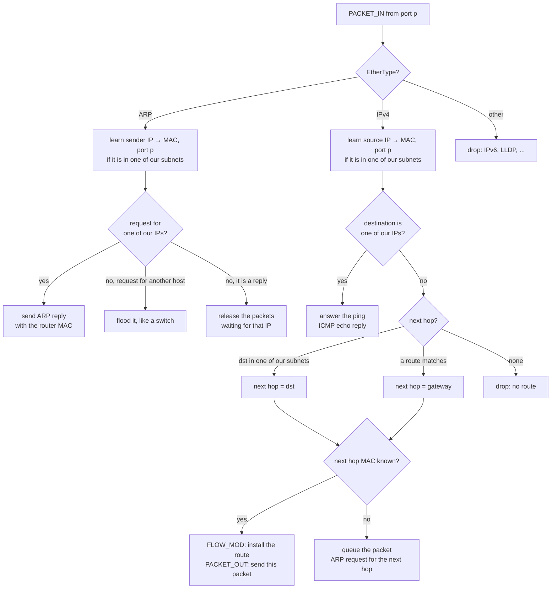
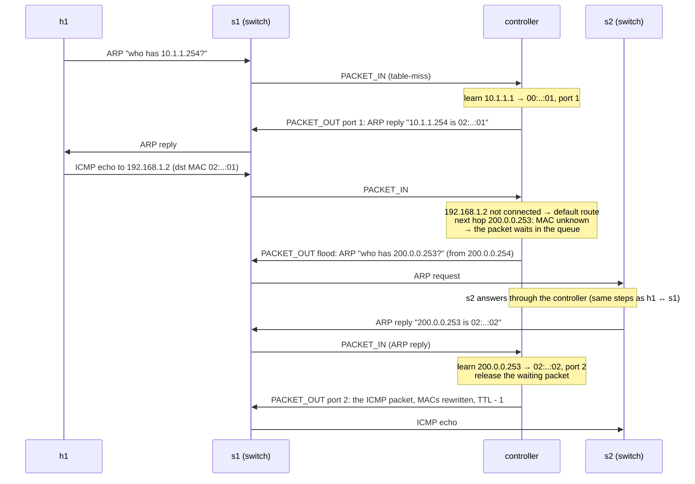

# 3. How the router works

[← The lab topology](02-topology.md) · [Home](README.md) · [Next: the flow rules →](04-flow-rules.md)

Each switch has, inside the controller, a **router object** with:

- its **configuration**: addresses (`10.1.1.254/24`, …) and routes (`0.0.0.0/0 via 200.0.0.253`), from the REST API;
- its **ARP table**: for each host it has seen, `IP → (MAC, port)`, learned from the traffic;
- a **waiting queue**: packets that wait for an ARP answer.

When a switch connects, the controller writes one single rule, the **table-miss**: "every packet that matches nothing else, send it to me". So at the beginning **every packet reaches the controller**.

## What the controller does with a packet



This is the function `packet_in()` of [`rest_router.py`](../rest_router.py), with `_handle_arp()` and `_handle_ipv4()`.

## Longest prefix match

The next hop is chosen like in any IP router:

1. if the destination is in one of the router's subnets → it is **directly connected**: deliver it to the host itself;
2. otherwise, among the routes that contain the destination, take the one with the **longest prefix** (`/24` wins over `/16`, which wins over `/0`);
3. no route → drop.

The default route `0.0.0.0/0` contains every address, with the shortest possible prefix: it is used only when nothing better exists.

## The first ping, step by step

`h1 ping h2`. `h1` (`10.1.1.1`) sees that `192.168.1.2` is not in its subnet, so it sends the packet to its gateway `10.1.1.254`, which is `s1`.

### At `s1`: ARP for the gateway, then the route



### At `s2`: the same, towards `h2`

`s2` receives the packet. `192.168.1.2` is in its subnet `192.168.1.0/24`, so the next hop is `h2` itself. `s2` does not know its MAC yet: the packet waits, `s2` sends `ARP "who has 192.168.1.2?"` from `192.168.1.254`, `h2` answers, and the packet is delivered.

The source `10.1.1.1` is **not** learned by `s2`: it is not in one of its subnets, and the MAC on the packet is the one of `s1`, not the one of `h1`.

### The way back

`h2` answers with an ICMP echo reply to `10.1.1.1`. It sends it to its gateway `192.168.1.254` (ARP first, answered by `s2`), and the same steps happen in the other direction.

### The next packets

From the second ping on, every router knows the MAC of the next hop. At the next `PACKET_IN` for the same destination, the controller installs a **flow rule** for it (see [the flow rules](04-flow-rules.md)). From then on the switch forwards the packets **by itself**, without asking the controller.

You can see it in the times of the ping (real run):

```
64 bytes from 192.168.1.2: icmp_seq=1 ttl=62 time=42.3 ms    ← ARP + controller
64 bytes from 192.168.1.2: icmp_seq=2 ttl=62 time=20.3 ms    ← flow rules installed
64 bytes from 192.168.1.2: icmp_seq=3 ttl=62 time=18.8 ms
```

`ttl=62`: `h2` sends the reply with TTL 64, and each router decrements it by one (`dec_ttl`). Two routers → 62. This is the proof that the packet was really **routed**, not just switched.

## Rewriting the packet

A router changes three fields of every packet it forwards:

| Field | Before (leaving `h1`) | After `s1` | Why |
|---|---|---|---|
| source MAC | `00:00:00:00:00:01` (`h1`) | `02:00:00:00:00:01` (`s1`) | the frame now comes from the router |
| destination MAC | `02:00:00:00:00:01` (`s1`) | `02:00:00:00:00:02` (`s2`) | the next hop on the new link |
| IP TTL | 64 | 63 | one router crossed |

The IP addresses `10.1.1.1 → 192.168.1.2` do **not** change: they are end to end. The MAC addresses change at every hop.

## Ping to the router

`h1 ping 10.1.1.254` is answered by the controller itself (`_answer_ping()`): it builds the ICMP echo reply and sends it with a `PACKET_OUT`. No flow rule is installed for it, so **every** ping to a router address goes through the controller. In the real run it takes about 4.8 ms: 4 ms are the delay of the link `h1`–`s1` (2 ms each way), the rest is the trip to the controller and back.

## When the state is reset

| Event | What the controller does |
|---|---|
| new address or route via REST | deletes its route rules from that switch (`cookie=0x1`): they are recomputed with the new configuration |
| a switch connects (or reconnects) | forgets the learned hosts of that switch (ARP table, waiting packets); **keeps** the configuration |
| a rule is unused for 60 s | the switch deletes it (`idle_timeout=60`); the next packet installs it again |
