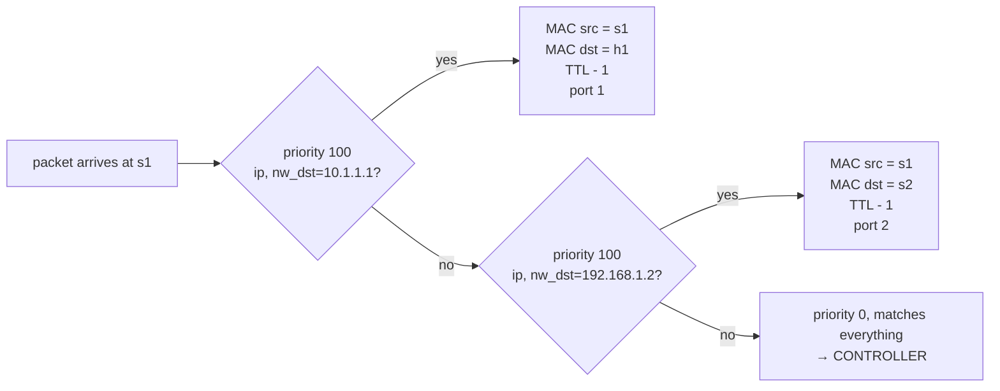

# 4. The flow rules

[← How the router works](03-how-the-router-works.md) · [Home](README.md) · [Next: the REST API →](05-rest-api.md)

The controller decides, but the switch forwards. What it forwards with is its **flow table**: a list of rules `match → actions`, checked by **priority** (the highest first).

## Read the table

At the `mininet>` prompt, after `h1 ping -c3 h2`:

```
mininet> sh ovs-ofctl -O OpenFlow13 dump-flows s1
```

Real output:

```
 cookie=0x1, duration=4.326s, table=0, n_packets=2, n_bytes=196, idle_timeout=60, priority=100,ip,nw_dst=10.1.1.1 actions=set_field:02:00:00:00:00:01->eth_src,set_field:00:00:00:00:00:01->eth_dst,dec_ttl,output:1
 cookie=0x1, duration=3.281s, table=0, n_packets=1, n_bytes=98, idle_timeout=60, priority=100,ip,nw_dst=192.168.1.2 actions=set_field:02:00:00:00:00:01->eth_src,set_field:02:00:00:00:00:02->eth_dst,dec_ttl,output:2
 cookie=0x0, duration=4.392s, table=0, n_packets=21, n_bytes=2409, priority=0 actions=CONTROLLER:65535
```

`-O OpenFlow13` is needed: the switches speak only OpenFlow 1.3, and `ovs-ofctl` uses 1.0 by default.

## Two kinds of rules



### The table-miss rule (priority 0)

```
priority=0 actions=CONTROLLER:65535
```

- no match fields: it matches **every** packet;
- priority 0, the lowest: it is used only when no other rule matches;
- `CONTROLLER:65535`: send the packet to the controller, **whole** (65535 = no limit on the bytes sent; the controller needs the full packet to forward it later).

Installed once, when the switch connects (`switch_features()` in the code).

### The route rules (priority 100)

```
cookie=0x1, idle_timeout=60, priority=100,ip,nw_dst=192.168.1.2
actions=set_field:02:00:00:00:00:01->eth_src,set_field:02:00:00:00:00:02->eth_dst,dec_ttl,output:2
```

| Part | Meaning |
|---|---|
| `ip` | only IPv4 packets (EtherType `0x0800`) |
| `nw_dst=192.168.1.2` | with this destination IP address |
| `set_field:…->eth_src` | the source MAC becomes the router's MAC |
| `set_field:…->eth_dst` | the destination MAC becomes the next hop's MAC (here `s2`) |
| `dec_ttl` | TTL − 1 (and the switch drops the packet if TTL reaches 0) |
| `output:2` | out of port 2 |
| `cookie=0x1` | a label: the controller deletes all the rules with this cookie when the configuration changes |
| `idle_timeout=60` | the switch deletes the rule after 60 s without packets |

There is **one rule per destination host** (`nw_dst` is a single address, `/32`). A real router would have one rule per subnet; here the rule needs the MAC of the destination host when it is directly connected, so a per-host rule is the simplest.

## The counters

`n_packets` and `n_bytes` grow every time a packet matches the rule:

- `n_packets=1` for `192.168.1.2` after 3 pings: the first echo request went through the controller (waiting for ARP), the second one installed the rule and was sent by the controller too, only the third one matched it.
- `n_packets=21` on the table-miss: ARP requests and replies, the first packets of each flow, the IPv6 packets the hosts send at start (dropped by the controller).

Run the ping again and dump the flows: the counters of the route rules grow, the one of the table-miss does not. **The switch works alone.**

## Watch the rules expire

```
mininet> h1 ping -c1 h2
mininet> sh ovs-ofctl -O OpenFlow13 dump-flows s1
```

wait one minute, then dump the flows again: the route rules are gone (`idle_timeout=60`). The next ping goes through the controller again and installs them again.
