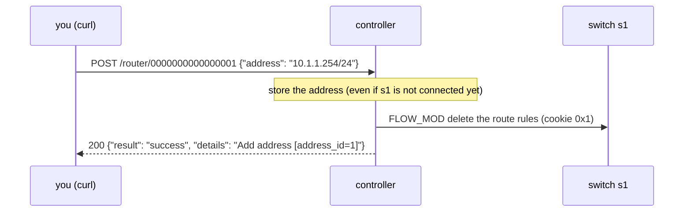

# 5. The REST API

[← The flow rules](04-flow-rules.md) · [Home](README.md) · [Next: running the lab →](06-running-the-lab.md)

The controller listens for HTTP requests on port **8080**. The URLs and the JSON are the same of Ryu's `rest_router`, so the scripts written for Ryu work unchanged.



## Endpoints

| Method and URL | Body | What it does |
|---|---|---|
| `POST /router/<dpid>` | `{"address": "10.1.1.254/24"}` | adds an address (and so a directly connected subnet) to the router |
| `POST /router/<dpid>` | `{"gateway": "200.0.0.253"}` | sets the **default route** |
| `POST /router/<dpid>` | `{"destination": "172.16.0.0/16", "gateway": "200.0.0.253"}` | adds a **static route** |
| `GET /router/<dpid>` | | shows the configuration of one router |
| `GET /router/all` | | shows the configuration of all the routers |

`<dpid>` is the switch id with 16 hexadecimal digits: `0000000000000001` for `s1`, `0000000000000002` for `s2`.

The address must have a prefix (`/24`): it tells the router which subnet is directly connected. The gateway must be in one of these subnets, otherwise the router cannot reach it.

## Examples

Run them from any terminal of the machine, while the controller is running.

**Add an address**

```bash
curl -X POST -d '{"address": "10.1.1.254/24"}' http://localhost:8080/router/0000000000000001
```

```json
[
  {
    "switch_id": "0000000000000001",
    "command_result": [
      {
        "result": "success",
        "details": "Add address [address_id=1]"
      }
    ]
  }
]
```

Sending the **same** address again does not add it twice:

```json
        "details": "Address already set [address_id=1]"
```

**Set the default route**

```bash
curl -X POST -d '{"gateway": "200.0.0.253"}' http://localhost:8080/router/0000000000000001
```

```json
        "details": "Add route [route_id=1]"
```

A second `gateway` for the same destination **replaces** the first one.

**Show the configuration**

```bash
curl http://localhost:8080/router/0000000000000001
```

```json
[
  {
    "switch_id": "0000000000000001",
    "mac": "02:00:00:00:00:01",
    "address": [
      {"address_id": 1, "address": "10.1.1.254/24"},
      {"address_id": 2, "address": "200.0.0.254/24"}
    ],
    "route": [
      {"route_id": 1, "destination": "0.0.0.0/0", "gateway": "200.0.0.253"}
    ]
  }
]
```

**An error**

```bash
curl -X POST -d '{"address": "10.1.1.254"}' http://localhost:8080/router/0000000000000001
```

```json
        "result": "failure",
        "details": "address needs a prefix, e.g. 10.0.0.1/24"
```

## Configuration before the switch connects

The controller **accepts the configuration even if the switch is not connected yet**, and uses it as soon as the switch arrives. This matters in [`router_topology.py`](../router_topology.py): it sends the `curl` requests right after `net.start()`, when the switches may still be connecting.

## Differences from Ryu's rest_router

| Ryu `rest_router` | `rest_router.py` |
|---|---|
| addresses, default route, static routes | ✅ the same |
| `GET` of the configuration | ✅ (the JSON is simpler) |
| `DELETE` of addresses and routes | ❌ not implemented: restart the controller to start from scratch |
| VLAN (`/router/<dpid>/<vlan>`) | ❌ not implemented |
| one MAC per port | one MAC per switch (see [the topology](02-topology.md)) |
| configuration only for connected switches | also before the switch connects |
