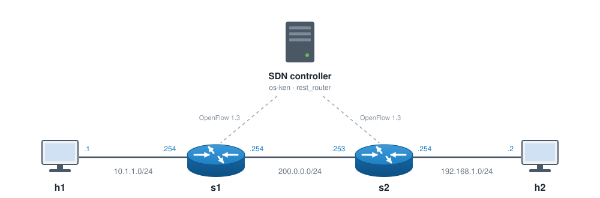

# rest_router: an SDN router with os-ken

This wiki explains the lab of `12_4_REST_ROUTER`: two OpenFlow switches become **IPv4 routers**, and all the routing logic runs in a **controller** written in Python with [os-ken](https://opendev.org/openstack/os-ken). The routers are configured at runtime with a **REST API**, like a real SDN network.

## Pages

| # | Page | What you learn |
|---|---|---|
| 1 | [SDN in one picture](01-sdn-concepts.md) | data, control and management plane; what a controller does; OpenFlow messages |
| 2 | [The lab topology](02-topology.md) | hosts, routers, subnets, ports, MAC and IP addresses |
| 3 | [How the router works](03-how-the-router-works.md) | ARP, the first packet, the next ones: step by step, with sequence diagrams |
| 4 | [The flow rules](04-flow-rules.md) | the rules the controller writes into the switch, field by field, and how to read them |
| 5 | [The REST API](05-rest-api.md) | how to configure addresses and routes, with requests and answers |
| 6 | [Running the lab](06-running-the-lab.md) | install, start the controller, run the scripts, what you should see |
| 7 | [Troubleshooting](07-troubleshooting.md) | the most common problems and how to fix them |
| 8 | [Exercises](08-exercises.md) | ideas to explore and extend the router |

## Files of the lab

| File | What it is |
|---|---|
| [`rest_router.py`](../rest_router.py) | the controller application (the router) |
| [`run_controller.py`](../run_controller.py) | starts os-ken applications |
| [`router_topology.py`](../router_topology.py) | the network of the picture, configured via REST, then the Mininet CLI |
| [`router_topology_iperf.py`](../router_topology_iperf.py) | the same network, then a 10 s UDP iperf test from `h2` to `h1` |

## Why `rest_router.py` and not Ryu

The lab follows the [Ryu book, *REST Router*](https://osrg.github.io/ryu-book/en/html/rest_router.html). Ryu is no longer maintained (last release 2020, Python ≤ 3.7). Its maintained fork, **os-ken**, is a library for OpenStack and no longer ships the example applications nor the `ryu-manager` command. `rest_router.py` re-implements the part of Ryu's `rest_router` used in the lab, with the **same URLs and JSON**, on os-ken and Python 3.14.
