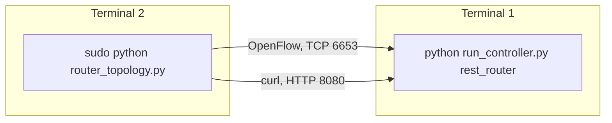

# 6. Running the lab

[← The REST API](05-rest-api.md) · [Home](README.md) · [Next: troubleshooting →](07-troubleshooting.md)

## Before you start

Containernet installed in the conda environment `cn`, as in [12_0_INSTALL](../../12_0_INSTALL). Then add os-ken, once:

```bash
conda activate cn
pip install os-ken==4.2.2
```

## Two terminals

The controller and the network are two separate programs: they talk over TCP, like a real controller and real switches. Use two terminals (or two tmux panes), both in the folder `12_CONTAINERNET/12_5_REST_ROUTER`, both with `conda activate cn`.



### Terminal 1: the controller

```bash
python run_controller.py rest_router
```

No `sudo`: the controller is a normal program. Leave it running. It prints what it does:

```
04:12:01 os_ken.base.app_manager: loading app rest_router
04:12:01 os_ken.base.app_manager: loading app os_ken.controller.ofp_handler
04:12:01 os_ken.base.app_manager: instantiating app rest_router of RestRouter
04:12:01 RestRouter: REST API on http://localhost:8080/router/<dpid>
```

### Terminal 2: the network

```bash
sudo "$CONDA_PREFIX/bin/python" router_topology.py
```

The script builds the network, configures the two routers with six `curl` requests, starts an iperf server on `h1` and `h2` (they write `h1_log.csv` and `h2_log.csv` in the current folder), and opens the Mininet CLI. Each `curl` answers `"result": "success"`.

In **terminal 1** you see the requests and, as soon as there is traffic, the routes:

```
04:12:01 RestRouter: s1: Add address [address_id=1] {'address': '10.1.1.254/24'}
04:12:01 RestRouter: REST "POST /router/0000000000000001 HTTP/1.1" 200 -
...
04:12:08 RestRouter: switch 0000000000000001 connected
04:12:10 RestRouter: s1: route 10.1.1.1 -> port 1 (next hop 00:00:00:00:00:01)
04:12:10 RestRouter: s1: route 192.168.1.2 -> port 2 (next hop 02:00:00:00:00:02)
```

Each switch appears as `connected` **twice**: the script switches it to OpenFlow 1.3 after the start (`ovs-vsctl set Bridge ... protocols=OpenFlow13`), and the switch reconnects. It is normal.

## Try it

At the `mininet>` prompt:

```
mininet> h1 ping -c3 h2
```

```
64 bytes from 192.168.1.2: icmp_seq=1 ttl=62 time=42.3 ms
64 bytes from 192.168.1.2: icmp_seq=2 ttl=62 time=20.3 ms
64 bytes from 192.168.1.2: icmp_seq=3 ttl=62 time=18.8 ms
3 packets transmitted, 3 received, 0% packet loss
```

The first ping is slower: ARP and the controller (see [how the router works](03-how-the-router-works.md)). `ttl=62`: two routers crossed.

Ping the routers:

```
mininet> h1 ping -c2 10.1.1.254
mininet> h2 ping -c2 192.168.1.254
```

Look at the rules (see [the flow rules](04-flow-rules.md)):

```
mininet> sh ovs-ofctl -O OpenFlow13 dump-flows s1
mininet> sh ovs-ofctl -O OpenFlow13 dump-flows s2
```

Ask the controller its configuration, from a third terminal:

```bash
curl http://localhost:8080/router/all
```

Leave the CLI with `exit`. The controller can stay on for the next run: it keeps the configuration and answers `Address already set` to the same requests.

## The iperf test

```bash
sudo "$CONDA_PREFIX/bin/python" router_topology_iperf.py
```

Same network, then 10 s of UDP at 1 Mbit/s from `h2` to `h1`, without the CLI. It writes `iperf_client_output.txt` and `iperf_server_output.txt` in the current folder. Real result:

```
[ ID] Interval       Transfer     Bandwidth        Jitter   Lost/Total Datagrams
[  1] 0.0000-10.7936 sec  1.25 MBytes   974 Kbits/sec   0.932 ms 0/894 (0%)
```

974 kbit/s on 1 Mbit/s links, **0 lost** out of 894: after the first packet the traffic flows on the rules of the switches, at the speed of the links.

## At the end

- Ctrl+C in terminal 1 stops the controller.
- If a run was interrupted, clean Mininet with `sudo "$CONDA_PREFIX/bin/mn" -c`.
