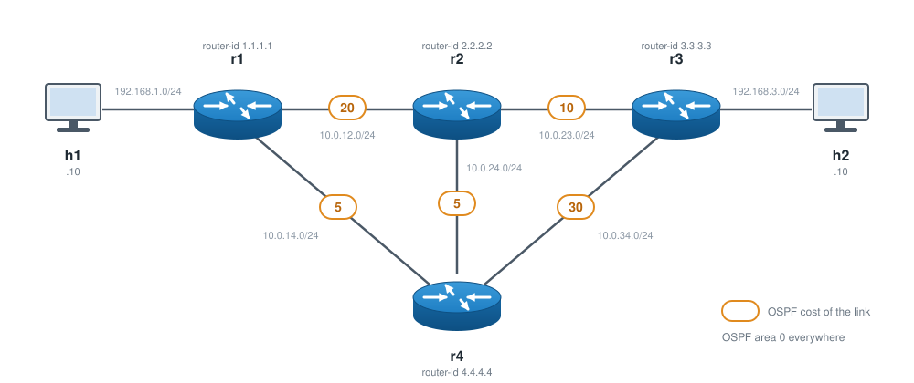
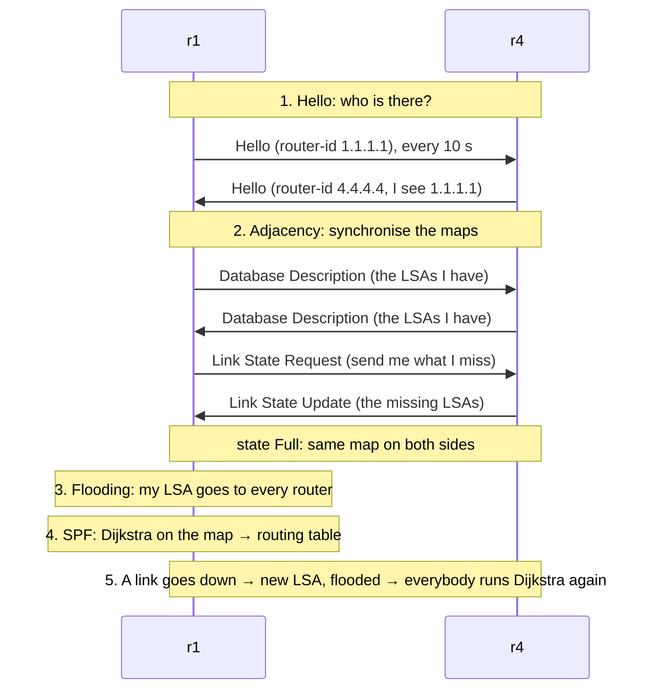

# 12.6 Dynamic routing with OSPF (Dijkstra)

Four routers, each one a Docker container running **[FRRouting](https://frrouting.org/)** (FRR), compute their routing tables by themselves with **OSPF**: every router learns the whole map of the network and runs **Dijkstra** on it. You compute the same shortest paths by hand, check them on the routers, break some links and watch the network reroute.



The shortest path from `h1` to `h2` is **not** the one with fewest hops: `r1 → r2 → r3` has 2 links but costs 30, `r1 → r4 → r2 → r3` has 3 links but costs 20.

## Files

| File | What it is |
|---|---|
| `ospf_topology.py` | builds the network (6 containers, 7 links), starts FRR on the routers, waits for OSPF, opens the CLI |
| `configs/r1.conf` … `r4.conf` | the FRR configuration of each router |
| `img/topology.svg` | the picture above |

---

## Theory

### Link-state routing

There are two big families of routing protocols:

| | Distance vector (e.g. RIP) | **Link state (e.g. OSPF)** |
|---|---|---|
| What a router tells its neighbors | "I reach network X at distance d" | "these are **my links** and their costs" |
| What a router knows | distances and next hops only | the **whole map** of the network |
| How it computes routes | Bellman-Ford, distributed, iteration after iteration | **Dijkstra**, locally, on the map |
| After a change | slow, can count to infinity | fast: the change is flooded, every router recomputes |

In a link-state protocol every router does the same three things: **describe** its own links, **flood** the description to all the other routers, **compute** the shortest paths on the map made of all the descriptions.

### OSPF in five steps

**OSPF** (Open Shortest Path First, [RFC 2328](https://www.rfc-editor.org/rfc/rfc2328)) is the link-state protocol used inside most organisations.



1. **Hello.** Every router sends a Hello on each OSPF interface every 10 s. Two routers that see each other in their Hellos become **neighbors**. If no Hello arrives for 40 s (the *dead interval*), the neighbor is considered gone.
2. **Adjacency.** Neighbors exchange the list of what they know and send each other what is missing. When the two maps are equal, the neighbor is in state **Full**.
3. **Flooding.** Each router describes itself in a **Router LSA** (Link State Advertisement): its links, the router on the other side, the cost. The LSAs are flooded to all the routers of the area. All together they form the **LSDB** (Link State DataBase): the map. Every router has **the same LSDB**.
4. **SPF.** Each router runs **Dijkstra** on the LSDB, with **itself as root**, and gets the shortest path tree towards every router and network. From the first hop of each path it builds its routing table.
5. **Change.** When a link goes down (or comes up, or changes cost), the routers on that link send a new LSA, it is flooded, and every router runs Dijkstra again.

### Dijkstra inside OSPF

The LSDB is a graph: routers are nodes, links are edges, the **OSPF cost** is the weight. This is the algorithm of Kurose & Ross, Sec. 5.2.1, run by every router with itself as source `u`:

```
N' = {u}
for every node v:  D(v) = c(u,v) if v is a neighbor of u, else ∞
repeat
    find w not in N' with the smallest D(w); add w to N'
    for every neighbor v of w not in N':
        D(v) = min( D(v), D(w) + c(w,v) )
until all the nodes are in N'
```

`D(v)` is the cost of the shortest path to `v`; the **predecessor** `p(v)` remembers through which node it goes, so the router can find the **first hop**: that is the only thing it writes in its routing table.

The cost of a route to a **network** (e.g. `192.168.3.0/24`) is the cost of the path to the router attached to it, **plus** the cost of that router's interface on the network.

### The OSPF settings of this lab

Here is `configs/r1.conf`, line by line:

```
interface r1-eth0
 ip ospf area 0
 ip ospf passive
interface r1-eth1
 ip ospf area 0
 ip ospf network point-to-point
 ip ospf cost 20
...
router ospf
 ospf router-id 1.1.1.1
```

| Setting | Meaning |
|---|---|
| `router-id 1.1.1.1` | the name of the router in OSPF: it identifies its LSA and appears in the neighbor tables. It looks like an IP address but it is only a 32-bit identifier |
| `ip ospf area 0` | this interface takes part in OSPF, in area 0 (the *backbone*). Large networks are split into areas; here there is only one |
| `ip ospf cost 20` | the weight of this link in Dijkstra. It is the cost to **leave** through this interface: the two ends of a link can have different costs. Here they are always equal |
| `ip ospf network point-to-point` | the link has only two routers: no need to elect a *Designated Router*, the adjacency is formed in a few seconds |
| `ip ospf passive` | announce this network (the hosts' LAN) in the LSA, but send no Hellos on it: there are no routers there |

Without an explicit `cost`, OSPF derives it from the bandwidth (reference 100 Mbit/s ÷ interface bandwidth). In the lab the costs are set by hand, so that the shortest path is not the obvious one. The hosts' LANs keep the default cost, **10**.

### FRRouting inside each router

FRR is the open-source routing suite used in many real routers and in Linux servers. In each router container run:

| Process | Job |
|---|---|
| `ospfd` | speaks OSPF: Hellos, LSAs, LSDB, Dijkstra |
| `zebra` | receives the best routes from `ospfd` and writes them into the **Linux kernel** routing table: the kernel forwards the packets |
| `mgmtd`, `staticd`, `watchfrr` | configuration, static routes, restarts a daemon that crashes |
| `vtysh` | the command line, with the same syntax as a Cisco router (`show ip ospf neighbor`, `configure terminal`, …) |

OSPF only **computes**: the forwarding is done by the kernel of the container, as in any Linux router (`net.ipv4.ip_forward=1`).

---

## The topology

| Link | Subnet | Cost |
|---|---|---|
| h1 – r1 | `192.168.1.0/24` (h1 `.10`, r1 `.1`) | LAN, 10 |
| r1 – r2 | `10.0.12.0/24` (r1 `.1`, r2 `.2`) | 20 |
| r1 – r4 | `10.0.14.0/24` (r1 `.1`, r4 `.4`) | 5 |
| r2 – r3 | `10.0.23.0/24` (r2 `.2`, r3 `.3`) | 10 |
| r2 – r4 | `10.0.24.0/24` (r2 `.2`, r4 `.4`) | 5 |
| r3 – r4 | `10.0.34.0/24` (r3 `.3`, r4 `.4`) | 30 |
| r3 – h2 | `192.168.3.0/24` (r3 `.1`, h2 `.10`) | LAN, 10 |

The addresses of a link between `rX` and `rY` are `10.0.XY.X` and `10.0.XY.Y`: from an address you know the router. The hosts have a default route to their router; the routers have no static routes at all: **everything is learned with OSPF**.

All the nodes are containers of the image `quay.io/frrouting/frr:10.4.5`. The first run downloads it (about 300 MB): on a lab machine, pull it in advance with `sudo docker pull quay.io/frrouting/frr:10.4.5`.

---

## The exercise

### Step 1. Dijkstra by hand

Before starting the network, run Dijkstra from `r1` on the graph of the picture. Fill a table like this one (`D(v),p(v)` = cost, predecessor):

| Step | N' | r2 | r3 | r4 |
|---|---|---|---|---|
| 0 | r1 | | | |
| 1 | | | | |
| 2 | | | | |
| 3 | | | | |

Then answer: through which router does `r1` send the packets for `h2`? With which cost for the network `192.168.3.0/24`?

<details>
<summary><b>Solution</b> (open it after you tried)</summary>

| Step | N' | r2 | r3 | r4 |
|---|---|---|---|---|
| 0 | r1 | 20, r1 | ∞ | **5, r1** |
| 1 | r1, r4 | **10, r4** | 35, r4 | |
| 2 | r1, r4, r2 | | **20, r2** | |
| 3 | r1, r4, r2, r3 | | | |

- Step 1: `r4` is the closest (5). Through `r4`, `r2` costs 5 + 5 = 10 < 20: update. `r3` through `r4` costs 5 + 30 = 35.
- Step 2: `r2` (10). Through `r2`, `r3` costs 10 + 10 = 20 < 35: update.
- Path to `r3`: `r1 → r4 → r2 → r3`, cost 20. **First hop: r4.**
- Cost of `192.168.3.0/24`: 20 + 10 (the LAN interface of `r3`) = **30**.

</details>

### Step 2. Start the network

```bash
conda activate cn
sudo "$CONDA_PREFIX/bin/python" ospf_topology.py
```

```
*** Starting FRRouting on the routers
*** Waiting for OSPF to converge ...............done in 15 s
*** Starting CLI:
containernet>
```

About 15 s: the routers must find each other with Hellos, form the adjacencies and flood their LSAs.

### Step 3. Neighbors and map

The neighbors of `r1`:

```
containernet> r1 vtysh -c "show ip ospf neighbor"
```
```
Neighbor ID     Pri State           Up Time         Dead Time Address         Interface
4.4.4.4           1 Full/-          3m52s             37.743s 10.0.14.4       r1-eth2:10.0.14.1
2.2.2.2           1 Full/-          1m12s             37.540s 10.0.12.2       r1-eth1:10.0.12.1
```

`Full`: the maps are synchronised. `-` instead of `DR`/`BDR`: point-to-point links, no election. `Dead Time` counts down from 40 s and goes back up at every Hello.

The LSDB, the map: one Router LSA per router. It is the same on all four routers (try `r3`):

```
containernet> r1 vtysh -c "show ip ospf database"
```
```
                Router Link States (Area 0.0.0.0)

Link ID         ADV Router      Age  Seq#       CkSum  Link count
1.1.1.1        1.1.1.1           72 0x8000000b 0xc423 5
2.2.2.2        2.2.2.2           72 0x8000000c 0xb31b 6
3.3.3.3        3.3.3.3          204 0x80000004 0xf487 5
4.4.4.4        4.4.4.4           73 0x80000008 0xb5ea 6
```

Inside the LSA of `r2` (filtered):

```
containernet> r1 vtysh -c "show ip ospf database router 2.2.2.2"
```
```
Link connected to: another Router (point-to-point)
(Link ID) Neighboring Router ID: 3.3.3.3
TOS 0 Metric: 10
Link connected to: another Router (point-to-point)
(Link ID) Neighboring Router ID: 1.1.1.1
TOS 0 Metric: 20
Link connected to: another Router (point-to-point)
(Link ID) Neighboring Router ID: 4.4.4.4
TOS 0 Metric: 5
```

These are exactly the edges of `r2` in the picture, with their weights: **the input of Dijkstra**. (Each point-to-point link also appears as a *Stub Network*: the subnet of the link.)

### Step 4. Check your Dijkstra

The routes computed by OSPF on `r1`:

```
containernet> r1 vtysh -c "show ip route ospf"
```
```
O   10.0.12.0/24 [110/20] is directly connected, r1-eth1, weight 1, 00:01:23
O   10.0.14.0/24 [110/5] is directly connected, r1-eth2, weight 1, 00:04:03
O>* 10.0.23.0/24 [110/20] via 10.0.14.4, r1-eth2, weight 1, 00:01:08
O>* 10.0.24.0/24 [110/10] via 10.0.14.4, r1-eth2, weight 1, 00:01:23
O>* 10.0.34.0/24 [110/35] via 10.0.14.4, r1-eth2, weight 1, 00:03:48
O   192.168.1.0/24 [110/10] is directly connected, r1-eth0, weight 1, 00:04:03
O>* 192.168.3.0/24 [110/30] via 10.0.14.4, r1-eth2, weight 1, 00:01:08
```

- `[110/30]`: **110** is the *administrative distance* of OSPF (how much the router trusts the source of the route), **30** the OSPF cost: the same as your table.
- `via 10.0.14.4`: the first hop is `r4`, as computed by hand.
- `O>*`: the route is the best one (`>`) and is installed in the kernel (`*`). The networks marked only `O` are directly connected: the kernel already knows them.

The path of the packets:

```
containernet> h1 traceroute -n 192.168.3.10
```

Output simplified: times removed, router names added.
```
 1  192.168.1.1     r1
 2  10.0.14.4       r4
 3  10.0.24.2       r2
 4  10.0.23.3       r3
 5  192.168.3.10    h2
```

### Step 5. Break a link

Before you type, compute the new shortest path from `r1` to `r3` without the link `r2 – r4`.

```
containernet> link r2 r4 down
containernet> h1 traceroute -n 192.168.3.10
containernet> r1 vtysh -c "show ip route 192.168.3.0/24"
```

| Links down | Path `h1 → h2` | Metric of `192.168.3.0/24` on r1 |
|---|---|---|
| none | r1 → r4 → r2 → r3 | 30 |
| `r2 – r4` | r1 → r2 → r3 | 40 (20 + 10 + 10) |
| `r2 – r4` and `r1 – r2` | r1 → r4 → r3 | 45 (5 + 30 + 10) |

The new route appears in less than 3 s: when an interface goes down, OSPF does not wait for the dead interval, it sends a new LSA at once.

Break the second link too (`link r1 r2 down`) and check the third row. Then bring both back (`link r2 r4 up`, `link r1 r2 up`): after about 15 s, the time to rebuild the adjacencies, the path is the first one again.

### Step 6. Change a cost

Make the link `r1 – r4` expensive, **only on the side of r1**:

```
containernet> r1 vtysh -c "configure terminal" -c "interface r1-eth2" -c "ip ospf cost 50"
```

Before checking, answer:

1. Which path does `h1 → h2` take now? With which metric?
2. The cost changed only on `r1`'s interface. Does the **reply** `h2 → h1` follow the same path backwards? (Run Dijkstra from `r3`, then check with `h2 traceroute -n 192.168.1.10`.)
3. Put the cost back to 5. How long does the network take to go back?

---

## Notes

- Leave the CLI with `exit`. If a run was interrupted: `sudo "$CONDA_PREFIX/bin/mn" -c` (it removes the containers too).
- An interactive shell of a router, with the Cisco-like prompt: `sudo docker exec -it mn.r1 vtysh`.
- When the network starts, Mininet prints `Error setting r1-eth1 up:` (with nothing after the colon) for every link. It is harmless: Mininet takes any output of the command as an error, but the interfaces are up.
- The routers need the capabilities `NET_ADMIN`, `NET_RAW` and `SYS_ADMIN` (set in `ospf_topology.py`): without them FRR does not start and the script stops at *Starting FRRouting*.
